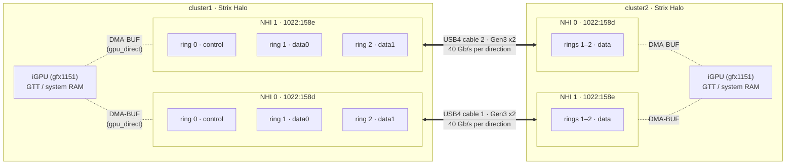
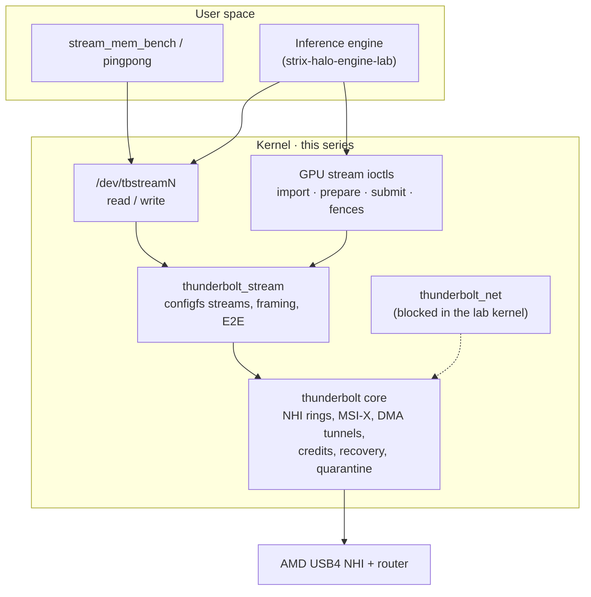
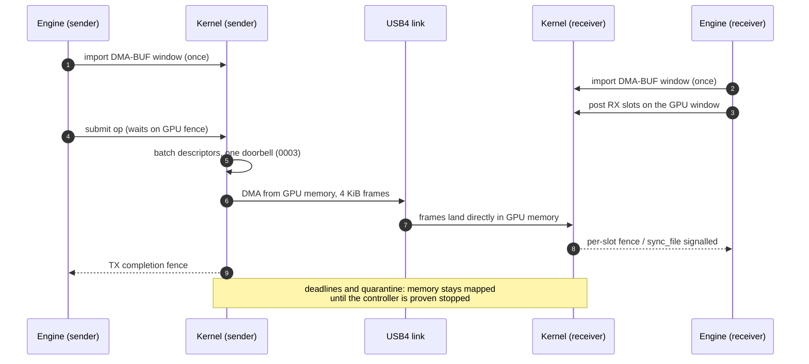
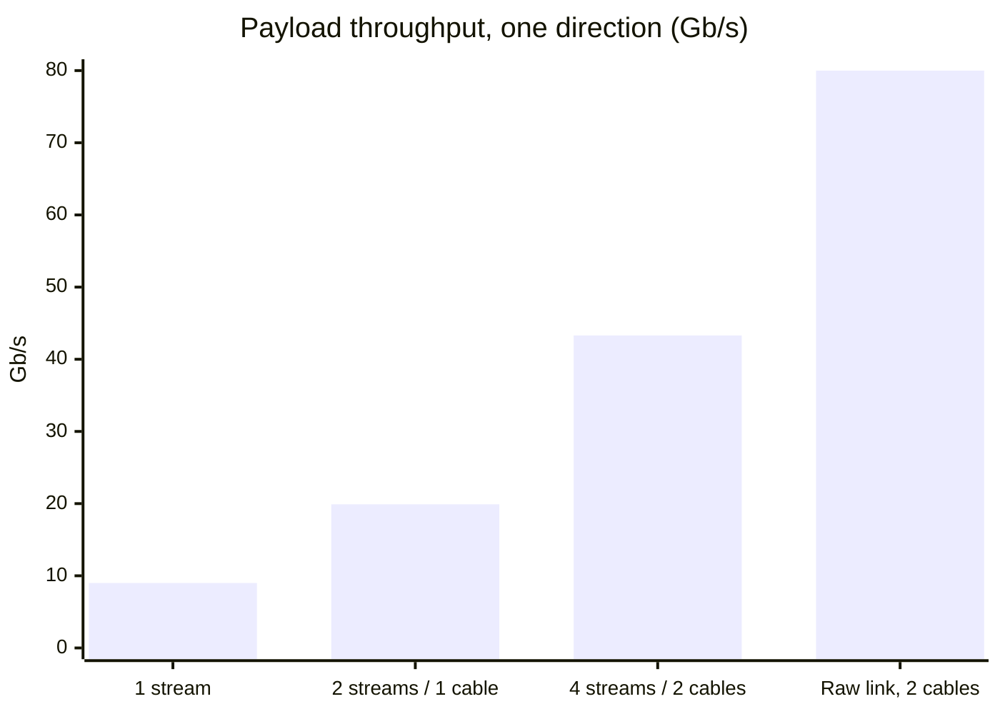
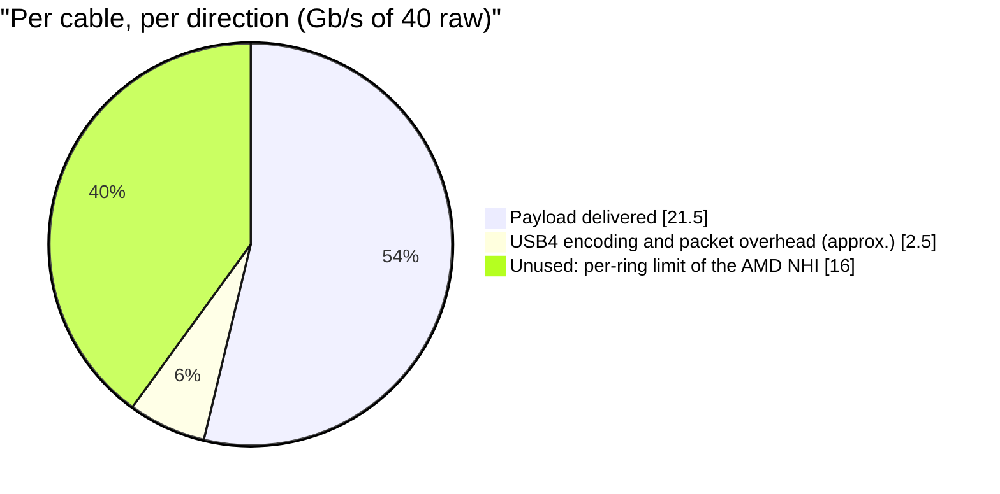
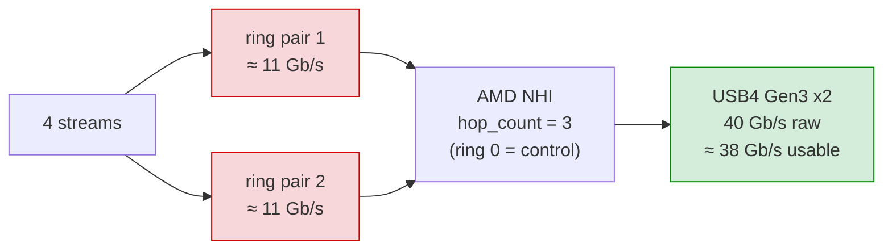

# Strix Halo USB4 driver

Linux kernel patch series that turns the native AMD USB4 host controllers of
two **AMD Ryzen AI Max+ 395 ("Strix Halo")** machines into a direct DMA
interconnect for distributed LLM inference: USB4STREAM character devices for
host memory, plus a DMA-BUF extension that moves data between the two iGPUs
without staging through TCP.

The series applies to Linux `72d3fcf802c45d00b300f25b848a93c3a2bd7c7e`
(**7.3-rc5**). All nine patches in [`patches/series`](patches/series) are the
driver; `overlay/` is an immutable capture of the original source and is *not*
the current driver on its own.

> **Status (2026-10-17):** the series applies cleanly, passes the offline test
> suite and builds with zero warnings. The bandwidth and latency figures below
> were measured on hardware with the previously deployed module (0001 + MSI-X
> fixes). The complete 0001–0009 series has **not** yet been loaded on hardware
> and is not production-qualified. See [Status](#status).

## Contents

- [Hardware](#hardware)
- [Measured performance](#measured-performance)
- [What the series adds](#what-the-series-adds)
- [Status](#status)
- [The ~21.5 Gb/s per-cable ceiling](#the-215-gbs-per-cable-ceiling)
- [Comparison with other USB4 interconnects](#comparison-with-other-usb4-interconnects)
- [Build and test](#build-and-test)
- [Runtime configuration](#runtime-configuration)
- [Deployment and safety](#deployment-and-safety)
- [Roadmap](#roadmap)
- [Repository layout](#repository-layout)
- [Documentation history](#documentation-history)
- [Attribution and licence](#attribution-and-licence)

## Hardware

| Item | Value |
|---|---|
| Machines | 2 × BOSGAME M5 (Sixunited AXB35-02 board, AMI BIOS 3.11, 2026-05-08), 128 GB |
| USB4 host routers | AMD `1022:158d` and `1022:158e` (one per USB4 port), Parade retimers `1da0:8833` |
| Cabling | Two 40 Gb/s USB4 cables, crossed between the machines (two independent links) |
| Negotiated link | Gen3 × 2 lanes on both cables: **40 Gb/s per cable per direction** |
| NHI rings | `REG_CAPS` = `0x00000003` → `hop_count` = 3 on all four NHIs: ring 0 is control, **2 data ring pairs per controller** |
| Kernel in use | `7.3.0-rc5-strix-gpu-bosgame-20261014` |

### Topology



The cables are crossed (front port of one machine to rear port of the other).
Each controller exposes three ring pairs. Ring 0 carries the control channel,
so each cable has **two data ring pairs**: four USB4STREAM devices per machine
(`/dev/tbstream0..3`).

### Software stack



### GPU-to-GPU transfer



The link speed is read from `/sys/bus/thunderbolt/devices/*/{rx,tx}_speed`
(20.0 Gb/s per lane × 2 lanes). Current link speed and CLx state can be
confirmed from `LANE_ADP_CS_1` in debugfs. On these machines CL0s/CL1/CL2 are
disabled on all lanes and the current speed field reports Gen3. One port has
previously trained at Gen2 after a cold start and needed a replug, so check the
link speed after every boot.

## Measured performance

Both machines, 2026-10-17, deployed module (`thunderbolt` srcversion
`89426D53…`, `thunderbolt_stream` `C8E785E6…`). Host-memory transfers with
`stream_mem_bench`: 8 GiB per stream, 1 MiB writes, position-dependent pattern
verified by the receiver (zero bad chunks in every run). Aggregates are computed
over a common receiver-clock window.

### Bandwidth (one direction)

| Configuration | Aggregate | Per stream | Receiver CPU per 8 GiB |
|---|---:|---:|---:|
| 1 stream | 8.8–9.3 Gb/s | 8.8–9.3 | ~1.5 s |
| 2 streams, 1 cable | 19.9 Gb/s | ~10.2 | ~1.5 s |
| **4 streams, 2 cables** | **42.6–44.3 Gb/s (~5.4 GB/s)** | ~11.0 | ~1.5 s |





Each data ring pair saturates at ~11 Gb/s, so each cable delivers ~21.5 Gb/s
per direction. Both directions run at that rate simultaneously (full duplex);
earlier opposite-direction runs measured ~21.5 Gb/s each way per cable.

### Latency (round trip, one stream, 2 000 samples after 200 warm-up)

| Configuration | 64 B | 4 KiB | 64 KiB |
|---|---:|---:|---:|
| Interrupts, `throttling=8192` (default) | 16–17 µs | 25–26 µs | 148 µs |
| Interrupts, `throttling=0` | 16.0 µs | 23.7 µs | 142 µs |
| `busy_poll=1` | **8.2 µs** | **15.7 µs** | 137 µs |

```mermaid
xychart-beta
    title "Round-trip latency, median (µs)"
    x-axis ["64 B", "4 KiB"]
    y-axis "µs" 0 --> 30
    bar [16.6, 25.4]
    bar [8.2, 15.7]
```



*First bar of each pair: interrupts (default). Second bar: `busy_poll=1`.*

Interrupt throttling has a negligible effect at this load. Ring polling halves
small-message latency, but it consumes a CPU core and is currently mutually
exclusive with `gpu_direct` (see [Roadmap](#roadmap)). Benchmark source:
[`tools/pingpong.c`](tools/pingpong.c) (`pingpong server|client /dev/tbstreamN size iters warmup`).

## What the series adds

| Patch | Purpose |
|---|---|
| `0001-usb4-current-source` | Captured baseline: USB4STREAM configfs streams, the experimental GPU DMA-BUF UAPI (`linux/strix_gpu_stream.h`), GPU ring framing and slot reuse, aligned imported windows, runtime DMA credits, selected core teardown/notification reverts (the upstream AMD DMA-teardown reset is removed), posted MSI-X acknowledgement and ring-arm fixes. |
| `0002-credit-accounting-and-link-diagnostics` | Validated `dma_credits` (1..127, applies to new tunnels), guards against inconsistent firmware credit values, shared RX credit budget, and MSI-X interrupt clear selected from the full TX/RX index (correct bank). |
| `0003-batch-gpu-ring-submission` | Publishes a batch of GPU descriptors with one `dma_wmb()` and a single doorbell write, instead of one doorbell per frame. |
| `0004-fence-and-stop-lifetime` | Fence and ring-stop lifetime guards. |
| `0005-gpu-queues-fences-and-session-recovery` | Bounded GPU operation queues (up to **8 operations per direction**), independent per-slot fences exported as `sync_file`, fail-closed session recovery. |
| `0006-dma-progress-idle-reset-and-quarantine-reaping` | DMA progress independent of the ioctl mutex, finite DMA deadlines, exclusive idle controller reset restricted to known AMD USB4 routers, and quarantine of DMA-visible memory until stop is proven. |
| `0007-external-dependency-errors` | Rejects failed external GPU dependencies and keeps readiness fences across retries. |
| `0008-detached-quarantine-and-notification-lifecycle` | Detached-peer quarantine reclamation by the original owner, bounded XDomain property notifications. |
| `0009-domain-retirement-and-cooperative-controller-recovery` | Safe retirement of quiescent contexts even with old FDs still open (RCU-protected poll, `kfree_rcu`), explicit group reset for up to 16 owner-held GPU FDs, and optional cooperative USB4NET close/reset/reopen. Unknown or active consumers veto a reset. |

Design rule throughout: a timeout, process exit, failed MMIO read or missing
PCI device is **never** treated as proof that DMA has stopped. Memory the
controller may still write to is kept until stop is proven.

Upstream backport, kept outside the series:
[`patches/kernel-backports/`](patches/kernel-backports/) contains the v7.3-rc7
fix `e6895021a328` *drm/amdkfd: fix dma_buf reference leak in
get_dmabuf_info* (Cc: stable), which affects the DMA-BUF import path. It applies
cleanly on 7.3-rc5.

### Fixes in branch `fix/apply-build-20261017`

As published, `main` could not be built:

- **0002 did not apply.** Its `nhi.c` hunk lacked trailing context, so
  `git apply` anchored it to end-of-file and rejected it, and
  `tools/prepare_overlay.py` failed on every run. Regenerated with full
  context.
- **0006 did not compile.** `dma_recovery.c` uses the
  `PCI_DEVICE_ID_AMD_1AH_*_NHI*` IDs that 0001 removes together with the
  upstream teardown reset. Only the IDs are restored (upstream values;
  `M70H_NHI0/1` = `0x158d/0x158e` are these machines), not the reverted quirk.
- **Two tests were broken.** `tests/test_audit.py` matched the kernel-doc line
  `* tb_available_credits() - …` before the definition and compiled comment
  text. Comment lines are now skipped.

## Status

| Check | Result |
|---|---|
| Series applies to pristine 7.3-rc5 (`git apply`) | ✅ all 9 patches |
| `prepare_overlay.py` vs applying the series to the kernel | ✅ byte-identical (22 files) |
| Offline unit tests (`unittest discover`) | ✅ 84 run, OK (1 bundle-only skip) |
| `thunderbolt.ko`, `thunderbolt_stream.ko`, `thunderbolt_net.ko` with `W=1` and the machines' running config | ✅ 0 warnings, 0 errors, `USB4_GPU_STREAM=y` and `=n` |
| Link negotiation Gen3 × 2 on both cables | ✅ verified in sysfs and lane registers |
| Host-memory bandwidth/latency on hardware | ✅ deployed module (0001 + MSI-X fixes), see above |
| GPU DMA-BUF transfers on hardware | ⚠️ limited test with the deployed module (8 × 4 190 208-byte sends verified, 2026-10-15) |
| Complete 0001–0009 series loaded on hardware | ❌ pending |
| Recovery, group reset, USB4NET cooperation on hardware | ❌ pending |
| GitHub Actions | ❌ earlier runs never executed a step; later commits are `[skip ci]` |

## The ~21.5 Gb/s per-cable ceiling

The links train at 40 Gb/s per direction, yet each cable carries ~21.5 Gb/s of
payload.



The link has headroom; the bottleneck is the per-ring rate of the controller. Each of the two data ring pairs per controller saturates at ~11 Gb/s
(about 336 000 4-KiB frames per second). The following were ruled out on
2026-10-17 with A/B/A runs (module reloads, no reboot, data verified):

| Hypothesis | Test | Result |
|---|---|---|
| DMA path credits | `dma_credits` 14 → 32; the router caps higher requests at 32, confirmed in the hop entry's `initial_credits` | no change |
| End-to-end flow control | `thunderbolt_stream` rebuilt without `RING_FLAG_E2E` | 43.7 Gb/s, no change |
| IOMMU translation | NHI IOMMU groups switched from `DMA-FQ` to `identity` | +3 % |
| Interrupt moderation | `throttling` 8192 / 1024 / 0 ns | no bandwidth change |
| PCIe read request size | NHI `MaxReadReq` 512 → 1024 → 4096 B | no gain (4096 slightly worse) |
| SoC / fabric clocks | `power_dpm_force_performance_level=high` | no change |
| Platform power mode | Quiet vs Balanced (EC byte `0x31`) | no change |
| CPU | ~25 % of one core per stream | not the limit |
| CLx / ASPM | disabled on all lanes and on the NHI links | not applicable |

Supporting evidence: other Strix Halo builds that use an **Intel Barlow Ridge
(Thunderbolt 5) NHI** instead of the AMD controller reach ~5 GB/s on a single
ring pair, and ~28–31 Gb/s over TCP versus ~9 Gb/s on the AMD NHI. Framework
has announced an AMD BIOS patch that raises USB4 point-to-point networking
"from 9 to about 30 Gb/s". The limit therefore appears to be in the AMD NHI
firmware or configuration. Software already uses every data ring the controller
exposes, so the remaining paths are a BIOS that includes AMD's change (not yet
published for the AXB35-02) or a different USB4 controller.

## Comparison with other USB4 interconnects

Reviewed at source level (OdinLink-Five `5c9e44b`); figures for the other
projects are as published by them.

| | This driver | OdinLink-Five | thunderbolt-ibverbs | strix-dual-exp |
|---|---|---|---|---|
| Interface | configfs streams + GPU DMA-BUF ioctls | ibverbs provider, RCCL/NCCL net plugin | ibverbs (`usb4_rdma`) | tbstream + TP2 serving |
| Controller in published results | AMD NHI, 2 × Strix Halo | Thunderbolt 5 oriented; its docs cite ~40 Gb/s | 2 × Strix Halo (TP=2 vLLM, ~20 tok/s on a 230B MoE) | Intel Barlow Ridge on Strix Halo |
| Rings per transfer | 1 pair per stream; 4 streams use all data rings | 1 pair per peer ("MIMO" = threads on the same pair) | — | 1 pair per session |
| Descriptor submission | batched, one doorbell per batch (0003) | one doorbell per frame | — | — |
| GPU path | DMA-BUF imported and mapped once, zero-copy TX and RX, `dma_resv` fences, `sync_file` | dma-buf attached/mapped per call, no fences; RCCL plugin advertises host pointers only | dma-buf MR | — |
| Failure handling | deadlines, quarantine, proven-stop reclamation, group reset | unmaps on signal with DMA possibly in flight | — | self-healing link |

Two ideas from OdinLink are worth adopting (see [Roadmap](#roadmap)): a hybrid
completion path (interrupts plus bounded busy-wait, compatible with zero-copy)
and an early ping/pong path verification before declaring a peer ready.

## Build and test

Full instructions: [docs/INSTALL-AND-TEST.md](docs/INSTALL-AND-TEST.md) and
[BUILD.md](BUILD.md).

### Reconstruct and run the offline tests

The builder needs a pristine checkout of the pinned kernel. It validates `tb.c`,
`tb.h` and USB4NET `main.c` from it against `provenance/lifecycle-base.json`.

```sh
git -C ../linux-pinned init -q
git -C ../linux-pinned fetch --depth 1 https://github.com/torvalds/linux.git \
    72d3fcf802c45d00b300f25b848a93c3a2bd7c7e
git -C ../linux-pinned checkout -q FETCH_HEAD

python3 tools/prepare_overlay.py audited-overlay --kernel-source ../linux-pinned
USB4_SOURCE_TREE="$PWD/audited-overlay" USB4_KERNEL_SOURCE="$PWD/../linux-pinned" \
    python3 -m unittest discover -s tests -v
```

Requires Python 3, Git and a C compiler with AddressSanitizer and
UndefinedBehaviorSanitizer. The tests compile real driver functions against
mocked kernel, HIP, MMIO and DMA boundaries. They do not emulate the NHI.

### Apply the series and build the modules

```sh
cd ../linux-pinned
while read -r p; do git apply --check "$OLDPWD/patches/$p" && git apply "$OLDPWD/patches/$p"; done \
    < "$OLDPWD/patches/series"
git apply "$OLDPWD"/patches/kernel-backports/*.patch      # optional, recommended

cp /boot/config-"$(uname -r)" .config
scripts/kconfig/merge_config.sh -m .config "$OLDPWD/config/usb4-gpu.fragment"
make olddefconfig
make -j"$(nproc)" W=1
make -j"$(nproc)" W=1 M=drivers/thunderbolt modules
```

Loadable modules must match the running kernel exactly (vermagic and
MODVERSIONS CRCs). Build them from the same tree and configuration as that
kernel, or build and install a complete new kernel with its own
`LOCALVERSION`.

## Runtime configuration

Streams are created in configfs under
`/sys/kernel/config/thunderbolt/stream/<service>/<name>/` and appear as
`/dev/tbstreamN`. The lab setup creates two streams per USB4 port:

| Attribute | Lab value | Notes |
|---|---|---|
| `ring_size` | 1024 | descriptors per ring |
| `throttling` | 8192 | interrupt moderation in ns; ~1 µs effect on latency, none on bandwidth |
| `busy_poll` | 0 | `1` halves small-message latency but burns a core; **rejected while `gpu_direct=1`** |
| `gpu_direct` | 0 | enables the DMA-BUF GPU path for that stream |
| `in_hopid` / `out_hopid` | -1 | auto allocation |

Module parameters: `thunderbolt.dma_credits` (default 14; the router accepts at
most 32; no measurable effect on these machines).

`thunderbolt_net` is blocked in the lab kernel through modprobe policy so that
both data ring pairs remain available to USB4STREAM. With it loaded, one stream
per controller is lost.

Diagnostics: `python3 tools/usb4_diagnose.py --logs` on both hosts.

## Deployment and safety

- **Keep the IOMMU enabled for the USB4 controllers.** The quarantine and
  reclamation logic relies on it to stop a misbehaving controller from writing
  into freed memory. If the GPU needs passthrough for performance, set it per
  IOMMU group (NHI groups stay `DMA-FQ`) instead of passing `iommu=pt` or
  `amd_iommu=off` globally.
- Keep a known-good boot entry. Use a distinct `LOCALVERSION` for every build.
- Bring up one machine first, verify both links (Gen3 × 2), run the bandwidth,
  latency and GPU tests, then the second machine.
- The IOMMU type of an NHI group can only be changed while no driver is bound.
  Unload `thunderbolt_stream` and `thunderbolt` first; reloading the core module
  keeps the Gen3 negotiation on these machines.

## Roadmap

1. Load the complete 0001–0009 series (plus the amdkfd backport) on one
   machine, then both: link, bandwidth, latency, GPU direct, recovery, group
   reset and USB4NET cooperation.
2. Hybrid completion on the GPU path: bounded busy-wait in the SGU event/wait
   path and in-line completion reaping only while operations are pending, so
   that `gpu_direct` gets polling-class latency (~8 µs RTT) without a
   permanently spinning core.
3. Optional per-CPU high-priority workqueue for ring work (measure first).
4. User-space sequence numbers in the GPU terminal frame and a ping/pong path
   check before marking a peer ready.
5. Boot-time check that warns when a link trains below Gen3.
6. Obtain an AXB35-02 BIOS that includes AMD's USB4 point-to-point change, then
   re-measure the per-ring ceiling.

## Repository layout

| Path | Content |
|---|---|
| `patches/series` | The nine-patch series, in order |
| `patches/audit-series` | Patches applied on top of the captured overlay (0002–0009) |
| `patches/kernel-backports/` | Unmodified upstream fixes applied after the series |
| `overlay/` | Immutable original source capture (equals pristine + 0001) |
| `base/` | Hash-pinned upstream files that the capture did not include |
| `provenance/` | Source manifests, pinned hashes, reference patches |
| `config/usb4-gpu.fragment` | Kconfig options needed by the driver |
| `tools/` | `prepare_overlay.py`, `validate_native.py`, `usb4_diagnose.py`, `pingpong.c` (latency benchmark) |
| `tests/` | Offline regression tests |
| `docs/` | Design and audit reports per patch level |

## Documentation history

Reports describe the state at their own patch level:

1. [Initial audit](docs/AUDIT-2026-10-16.md), patches 0002–0004.
2. [Queues and session recovery](docs/QUEUES-AND-RECOVERY.md), patch 0005.
3. [DMA progress and exclusive reset](docs/RECOVERY-2026-10-16.md), patch 0006.
4. [External dependencies](docs/EXTERNAL-DEPENDENCIES-2026-10-16.md), patch 0007.
5. [Detached lifecycle](docs/LIFECYCLE-2026-10-16.md), patch 0008.
6. [Cooperative recovery and retirement](docs/SOFTWARE-COMPLETION-2026-10-16.md), patch 0009.

The matching engine is `hyukudan/strix-halo-engine-lab`; its multi-slot entry
point is `strix-gpu-queue-visibility` (`lab/gpu_queue`, `--queue-depth 2..8`).

## Attribution and licence

The kernel changes are GPL-2.0-only; the UAPI header is
GPL-2.0 WITH Linux-syscall-note. Upstream files keep their own notices. The two
MSI-X fixes were adapted from
[CiruStrixLink](https://github.com/ciru-ai/CiruStrixLink/tree/master/kernel/linux-7.2.2).
See [ATTRIBUTIONS.md](ATTRIBUTIONS.md). No signing keys, binaries or private
hardware logs are committed.
