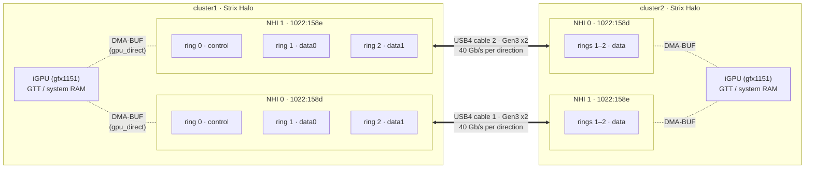
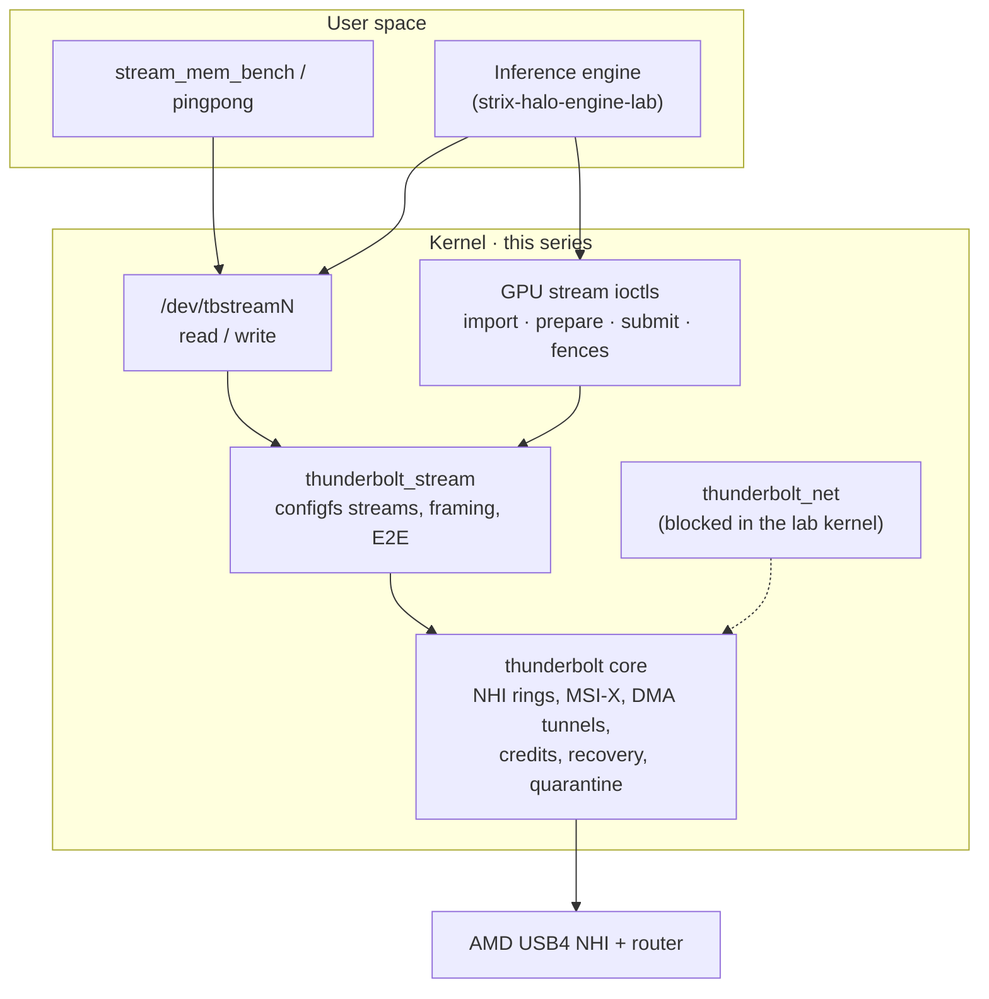
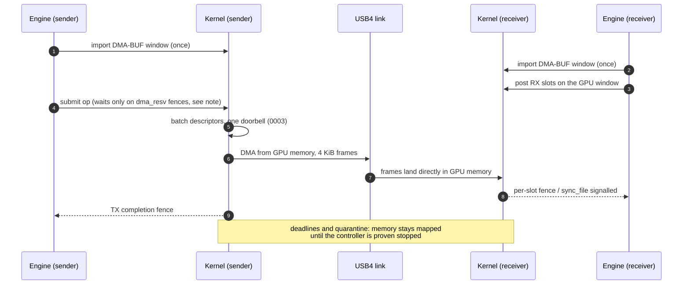
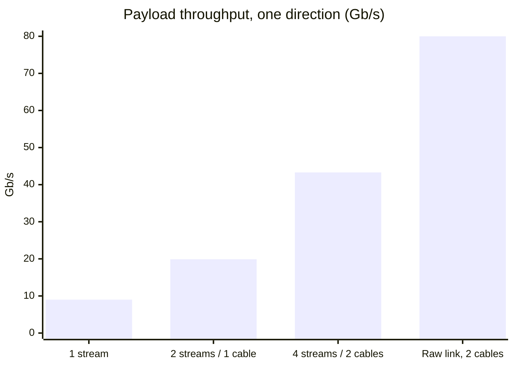
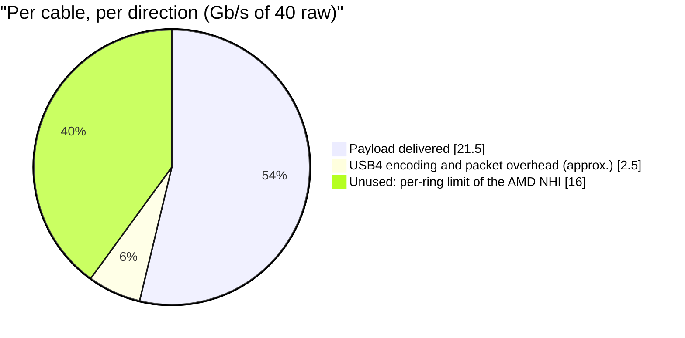
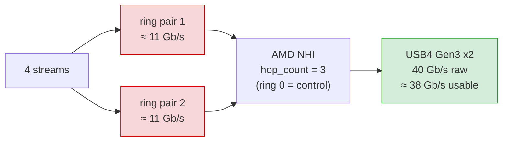

# Strix Halo USB4 driver

**AMD-first · independently developed direct interconnect.** This patch
series is tailored to AMD Strix Halo USB4 controllers and the direct GPU
transport needs of our
[Strix Halo inference engine](https://github.com/hyukudan/strix-halo-engine-lab)
and the longer-term
[TensorMeld](https://github.com/hyukudan/tensormeld) cluster.
It is our own Linux-kernel integration work, not a third-party inference
runtime or a replacement for the Linux kernel. It requires the specified
Linux source baseline, AMD hardware and kernel/driver interfaces; those
platform dependencies are distinct from relying on an external LLM engine.
The native engine and the interconnect are independently usable and
qualified in stages: working DMA paths do not alone establish distributed
inference performance or production readiness.

Linux kernel patch series that turns the native AMD USB4 host controllers of
two **AMD Ryzen AI Max+ 395 ("Strix Halo")** machines into a direct DMA
interconnect for distributed LLM inference: USB4STREAM character devices for
host memory, plus a DMA-BUF extension that moves data between the two iGPUs
without staging through TCP.

The series applies to Linux `72d3fcf802c45d00b300f25b848a93c3a2bd7c7e`
(**7.3-rc5**). All thirty-nine patches in [`patches/series`](patches/series) are the
driver; `overlay/` is an immutable capture of the original source and is *not*
the current driver on its own.

> **Status (2026-10-17):** the complete 0001–0010 series applies cleanly,
> passes the offline suite, builds with zero warnings and has been **loaded and
> exercised on both machines**: host-memory bandwidth and latency, 80 stream
> open/close cycles, GPU-to-GPU transfers (one-way, duplex, session recovery,
> controller group reset with and without USB4NET), all with zero kernel
> warnings. It is not yet installed as the default kernel and is not
> production-qualified. See [Status](#status).
>
> **Review fixes (2026-10-19, 0012–0016):** offline-tested and object-built
> only, **not yet run on hardware**. They fix a use-after-free and a hang on
> reboot/unbind with an armed `gpu_direct` session, a stream open failure that
> left every later open of that NHI failing with `ENOMEM`, the 0011 spin held
> under the device mutex, and add an opt-in kernel-validated GPU terminal
> frame. Validate them on the nodes before installing:
> [docs/REVIEW-FIXES-2026-10-19.md](docs/REVIEW-FIXES-2026-10-19.md).
>
> **0017 (2026-10-19), offline-tested and compile-tested only:** open RAM-ring
> streams are stopped when their stream goes away (unplug, unbind, rmdir,
> shutdown) instead of at close, and stale files fail with `ENODEV`. Domain
> removal now unregisters its XDomains and services, which used to outlive
> the domain and the module and crashed a reboot in `device_shutdown()`. A
> failed probe no longer waits forever, and the AMD v1 host interfaces are
> reset at probe: [docs/DETACH-FIXES-2026-10-19.md](docs/DETACH-FIXES-2026-10-19.md).
>
> **0018 (2026-10-19), offline-tested and compile-tested only:** after a DMA
> path teardown, an AMD v1 host interface is reset automatically to recover
> the upstream-documented TX hang, but only when no other ring (stream,
> USB4NET, GPU) uses that NHI. Attempts are bounded and the result is logged
> in `dmesg` (`thunderbolt.teardown_reset`, default on).
>
> **0019 (2026-10-19), offline-tested and compile-tested only:** `open()` of a
> stream no longer sleeps forever. It returns `ENODEV`/`ENXIO` at once when the
> endpoint's domain or XDomain does not exist, `EAGAIN` with `O_NONBLOCK`, and
> otherwise waits for the peer interruptibly until `open_timeout_ms` (30 s by
> default), then `ETIMEDOUT`.
>
> **0020–0039 (2026-10-19/20), offline-tested and compile-tested only:** fixes for
> the kernel findings of the external audit. They cover interrupt lifetime at
> NHI shutdown; stream state checked under the device mutex; resume failure;
> early RX; the DMA revoke proof; CRC/overrun; CLOSE with a full ring; partial
> I/O; close latency; the `spin_us` bound; non-blocking GPU submit; and a
> pending AMD teardown reset that runs once the NHI is free. 0033–0035 check
> lane bonding and the host router reset, and add an opt-in, bounded Gen3
> retrain. 0036–0039 close the windows a review of them found: `dma_lock` in
> non-blocking submit, a damaged CLOSE, pending-reset generations, contention
> and suspend, and Gen3 retrain locking and exclusion. 0032 adds missing
> kernel-doc lines:
> [docs/AUDIT-FIXES-2026-10-19.md](docs/AUDIT-FIXES-2026-10-19.md).

## Contents

- [Hardware](#hardware)
- [Measured performance](#measured-performance)
- [What the series adds](#what-the-series-adds)
- [Status](#status)
- [The ~21.5 Gb/s per-cable ceiling](#the-215-gbs-per-cable-ceiling)
- [Comparison with other USB4 interconnects](#comparison-with-other-usb4-interconnects)
- [Build and test](#build-and-test)
- [Runtime configuration](#runtime-configuration)
- [Deployment and safety](#deployment-and-safety)
- [Roadmap](#roadmap)
- [Repository layout](#repository-layout)
- [Documentation history](#documentation-history)
- [Attribution and licence](#attribution-and-licence)

## Hardware

| Item | Value |
|---|---|
| Machines | 2 × BOSGAME M5 (Sixunited AXB35-02 board, AMI BIOS 3.11, 2026-05-08), 128 GB |
| USB4 host routers | AMD `1022:158d` and `1022:158e` (one per USB4 port), Parade retimers `1da0:8833` |
| Cabling | Two 40 Gb/s USB4 cables, each one an independent link between one controller on each machine |
| Negotiated link | Gen3 × 2 lanes on both cables: **40 Gb/s per cable per direction** |
| NHI rings | `REG_CAPS` = `0x00000003` → `hop_count` = 3 on all four NHIs: ring 0 is control, **2 data ring pairs per controller** |
| Kernel in use | `7.3.0-rc5-strix-gpu-bosgame-20261019det` on both nodes (2026-10-19); each build has its own `-strix-gpu-bosgame-<id>` |

### Topology



The diagram shows the current cabling (front port of one machine to rear port
of the other). Any port pairing works and performs the same; what matters is
knowing which endpoint pairs with which. With this cabling NHI 0 on cluster1
talks to NHI 1 on cluster2 and vice versa, so stream and network configuration
pair `/dev/tbstream0` on cluster1 with `/dev/tbstream1` on cluster2, and so on.
After moving a cable, re-check the pairing from `/run/usb4stream-layout.json`
and the endpoint UUIDs instead of assuming it. The one port that once trained
at Gen2 did so regardless of which cable was plugged into it.

The layout file is written by the lab service
([`tools/lab/`](tools/lab/), see [docs/INSTALL-AND-TEST.md](docs/INSTALL-AND-TEST.md#5-lab-streams-and-the-layout-file)).
Since version 2 every `<service>/<stream>` entry keeps its `device` and
`configfs` keys and adds the local controller (PCI address, domain, USB4
port), the per-direction link speed and lanes, the remote host (name, UUID,
route), the hop IDs and whether the stream is openable; a `topology` section
groups the streams by cable. `usb4stream-describe` regenerates the same report
read-only at any time, and `--merge` combines the reports of both hosts into
the cable pairing (straight or crossed) and the `tbstreamN` pairs. Domain
numbers, and therefore the `D-R.S` service names, are assigned at probe time:
if one controller fails to probe, the other one becomes domain 0 and the
`tbstreamN` pairing changes. Rely on the topology, not on fixed indexes.

Each controller exposes three ring pairs. Ring 0 carries the control channel,
so each cable has **two data ring pairs**: four USB4STREAM devices per machine
(`/dev/tbstream0..3`).

### Software stack



### GPU-to-GPU transfer



**Synchronization contract with HIP/ROCm.** SUBMIT and RX_REPOST wait only for
fences published in the DMA-BUF's `dma_resv` (DRM command submission, Vulkan
implicit sync). HIP kernels run on KFD user queues that publish no such fence,
so with HIP memory the kernel cannot see GPU work: the application **must**
finish the producer (for example `hipStreamSynchronize`/`hipEventSynchronize`)
before SUBMIT, and finish every consumer of an RX window before RX_REPOST or
PREPARE of that slot. Otherwise the DMA reads data the GPU has not written yet,
or overwrites data it is still reading, with no error. This is the current
contract, pending confirmation on hardware and a design decision on explicit
in-fences; see [docs/REVIEW-FIXES-2026-10-19.md](docs/REVIEW-FIXES-2026-10-19.md).

The link speed is read from `/sys/bus/thunderbolt/devices/*/{rx,tx}_speed`
(20.0 Gb/s per lane × 2 lanes). Current link speed and CLx state can be
confirmed from `LANE_ADP_CS_1` in debugfs. On these machines CL0s/CL1/CL2 are
disabled on all lanes and the current speed field reports Gen3. One port has
previously trained at Gen2 after a cold start and needed a replug, so check the
link speed after every boot.

## Measured performance

Both machines, 2026-10-17, deployed module (`thunderbolt` srcversion
`89426D53…`, `thunderbolt_stream` `C8E785E6…`). Host-memory transfers with
[`tools/stream_mem_bench.c`](tools/stream_mem_bench.c): 8 GiB per stream, 1 MiB
writes, position-dependent pattern verified by the receiver (zero bad chunks in
every run). Aggregates are computed over a common receiver-clock window. These
are lab observations: the raw per-run logs of both ends were kept on the
machines and are not in this repository. [docs/BENCHMARKS.md](docs/BENCHMARKS.md)
lists what a reproducible measurement must record.

### Bandwidth (one direction)

| Configuration | Aggregate | Per stream | Receiver CPU per 8 GiB |
|---|---:|---:|---:|
| 1 stream | 8.8–9.3 Gb/s | 8.8–9.3 | ~1.5 s |
| 2 streams, 1 cable | 19.9 Gb/s | ~10.2 | ~1.5 s |
| **4 streams, 2 cables** | **42.6–44.3 Gb/s (~5.4 GB/s)** | ~11.0 | ~1.5 s |





Each data ring pair saturates at ~11 Gb/s, so each cable delivers ~21.5 Gb/s
per direction. Both directions run at that rate simultaneously (full duplex);
earlier opposite-direction runs measured ~21.5 Gb/s each way per cable.

### Latency (round trip, one stream, 2 000 samples after 200 warm-up)

| Configuration | 64 B | 4 KiB | 64 KiB |
|---|---:|---:|---:|
| Interrupts, `throttling=8192` (default) | 16–17 µs | 25–26 µs | 148 µs |
| Interrupts, `throttling=0` | 16.0 µs | 23.7 µs | 142 µs |
| `busy_poll=1` (interrupts off) | 8.2 µs | 15.7 µs | 137 µs |
| **`rx_napi=1 spin_us=25`** (0010, interrupts on) | **8.35 µs** | **15.9 µs** | **118 µs** |

```mermaid
xychart-beta
    title "Round-trip latency, median (µs)"
    x-axis ["64 B", "4 KiB"]
    y-axis "µs" 0 --> 30
    bar [16.6, 25.4]
    bar [8.35, 15.9]
```



*First bar of each pair: interrupts (default). Second bar: `rx_napi=1 spin_us=25` (patch 0010).*

Interrupt throttling has a negligible effect at this load. Patch 0010 gives
polling-class latency **without disabling interrupts**: the reader polls the RX
ring for at most `spin_us`, then re-arms the interrupt and sleeps. For bulk
transfers keep it off (with `spin_us=25` bulk throughput varied between −7 % and
0 %). The older `busy_poll` mode keeps a core spinning and is mutually exclusive
with `gpu_direct`. Benchmark source:
[`tools/pingpong.c`](tools/pingpong.c) (`pingpong server|client /dev/tbstreamN size iters warmup [timeout_ms]`;
both ends verify the full payload, each round trip is bounded by `timeout_ms`).
How to reproduce and record both benchmarks:
[docs/BENCHMARKS.md](docs/BENCHMARKS.md).

## What the series adds

| Patch | Purpose |
|---|---|
| `0001-usb4-current-source` | Captured baseline: USB4STREAM configfs streams, the experimental GPU DMA-BUF UAPI (`linux/strix_gpu_stream.h`), GPU ring framing and slot reuse, aligned imported windows, runtime DMA credits, selected core teardown/notification reverts (the upstream AMD DMA-teardown reset is removed), posted MSI-X acknowledgement and ring-arm fixes. |
| `0002-credit-accounting-and-link-diagnostics` | Validated `dma_credits` (1..127, applies to new tunnels), guards against inconsistent firmware credit values, shared RX credit budget, and MSI-X interrupt clear selected from the full TX/RX index (correct bank). |
| `0003-batch-gpu-ring-submission` | Publishes a batch of GPU descriptors with one `dma_wmb()` and a single doorbell write, instead of one doorbell per frame. |
| `0004-fence-and-stop-lifetime` | Fence and ring-stop lifetime guards. |
| `0005-gpu-queues-fences-and-session-recovery` | Bounded GPU operation queues (up to **8 operations per direction**), independent per-slot fences exported as `sync_file`, fail-closed session recovery. |
| `0006-dma-progress-idle-reset-and-quarantine-reaping` | DMA progress independent of the ioctl mutex, finite DMA deadlines, exclusive idle controller reset restricted to known AMD USB4 routers, and quarantine of DMA-visible memory until stop is proven. |
| `0007-external-dependency-errors` | Rejects failed external GPU dependencies and keeps readiness fences across retries. |
| `0008-detached-quarantine-and-notification-lifecycle` | Detached-peer quarantine reclamation by the original owner, bounded XDomain property notifications. |
| `0009-domain-retirement-and-cooperative-controller-recovery` | Safe retirement of quiescent contexts even with old FDs still open (RCU-protected poll, `kfree_rcu`), explicit group reset for up to 16 owner-held GPU FDs, and optional cooperative USB4NET close/reset/reopen. Unknown or active consumers veto a reset. |
| `0010-stream-rx-napi-hybrid-completion` | NAPI-style RX completion for streams: `start_poll` wakes the reader straight from the IRQ, the reader reaps frames itself (ring order preserved) and polls for up to `spin_us` before re-arming the interrupt. Halves small-message latency with interrupts kept on. The core no longer warns when stopping a `start_poll` ring that is legitimately masked. |
| `0011-stream-per-stream-napi-and-irq-steering` | Per-stream configfs `rx_napi`, `spin_us` and `irq_cpu` (pins the stream's TX/RX ring interrupts, CPU and GPU path), applied at open; `-1` keeps the module-wide behaviour. |
| `0012-cm-unlink-tunnels-on-stop` | `tb_stop()` unlinks every tunnel it frees, so the DMA inventory queried by domain retirement is empty instead of pointing at freed tunnels (use-after-free on reboot/unbind with an armed `gpu_direct` session). The query refuses a stale inventory after stop. |
| `0013-bounded-domain-release-and-dma-revocation` | A GPU context that cannot prove its DMA stopped no longer hangs reboot/unbind: domain teardown revokes and verifies the NHI's PCI bus mastering and releases such contexts (pending fences fail with `-ENODEV`); without that proof they are abandoned (leaked, never touched again) and the wait for the domain is bounded (30 s). After a configfs `rmdir`, quarantined contexts are reaped through `gpu_reap_orphans`. |
| `0014-stream-open-error-path-and-frame-arrays` | A stream open that failed after its DMA paths were enabled left the tunnel behind, so every later open of both streams of that NHI failed with `ENOMEM` until a module reload. The error path now disables the paths and frees everything; failures are logged. Frame bookkeeping arrays use `kvcalloc` (no order-4 allocation). |
| `0015-stream-spin-outside-device-mutex-and-irq-restore` | The `spin_us` busy-poll runs under a separate RX lock, without the device mutex, so `write()`/`poll()` of the same stream are no longer blocked for up to 1 ms. The previous IRQ affinity is restored when the stream stops; an offline `irq_cpu` or a refused change is logged. |
| `0016-gpu-kernel-validated-terminal-frame` | Opt-in `SGU_PREPARE_TERMINAL_HEADER`: TX sends a kernel-built terminal header, RX receives it in kernel memory and validates length, epoch, sequence, size and slot; a mismatch fails the operation with `SGU_FRAME_ERROR_TERMINAL` instead of silently shifting data. Advertised by `SGU_CAP_TERMINAL_HEADER`; the ABI layout and `abi_minor` are unchanged. |
| `0017-stream-detach-ram-rings-and-domain-xdomain-teardown` | Open RAM-ring streams stop when their service is removed, on configfs `rmdir` and on shutdown (new `.shutdown`); stale files get `ENODEV`, and a reconnect refuses new opens until they are closed. Domain removal unregisters XDomains and services before `tb_stop()` (they used to outlive the domain and the module, a stale-bus oops at reboot), so service drivers stop their rings before the DMA paths go down. Bounded wait on a failed probe; host interface reset at probe on the quirked AMD v1 NHIs. |
| `0018-amd-teardown-interface-reset-when-idle` | After a DMA path teardown on the AMD v1 NHIs, reset the host interface (recovers the upstream-documented TX hang that also stops the control channel), but only when no ring besides control and no DMA tunnel remain on that NHI. Never waits for the domain lock, up to 10 attempts over ~5 s, then a `dmesg` warning with the ring counts; success and failure are logged too. Not run during domain removal or suspend. `thunderbolt.teardown_reset` (default on). |
| `0019-stream-open-bounded-wait-for-peer` | `open()` with no stream attached: `ENODEV` at once if the endpoint's domain does not exist, `ENXIO` if its XDomain does not (or is unplugging), `EAGAIN` for `O_NONBLOCK`. Otherwise it waits interruptibly for the peer's stream service, re-checking the XDomain every second, up to `open_timeout_ms` (module parameter, 30 s; per-endpoint configfs override), then `ETIMEDOUT`. New core helper `tb_xdomain_presence()`. A two-node run had sat 27 min in `open()` on a domain that no longer existed. |
| `0020-nhi-shutdown-releases-ring-interrupts` | `nhi_shutdown()` frees the interrupt vector and cancels the work of every ring still registered (a retained or abandoned GPU context), so no handler or work item runs after the NHI, its MMIO and workqueue are gone. The ring memory stays quarantined. |
| `0021-stream-device-state-under-lock` | Stream validation, which dereferences the attached stream, only runs under the device mutex (lockdep-checked); wait conditions test the stream pointer without dereferencing it. Closes a use-after-free race with detach. |
| `0022-stream-resume-failure-fails-open-files` | A stream that cannot restart on resume fails its open files (`EPOLLHUP`/`EPOLLERR`, then `ENODEV` until closed) instead of leaving them on NULL rings; the other streams still resume. |
| `0023-stream-rx-counters-before-posting` | RX counters are reset before the buffers are posted, so a frame completing during open is not lost. |
| `0024-dma-revoke-proves-relaxed-ordering-off` | The DMA revocation proof at teardown also requires Relaxed Ordering off on the NHI and a valid register read (not all ones); otherwise the GPU context stays quarantined. |
| `0025-stream-damaged-rx-frame-fails-read` | A received frame with a CRC error or buffer overrun is no longer delivered as data: readers are woken, read returns the bytes before it and then `EIO`, and poll reports `EPOLLERR` until the file is closed. |
| `0026-stream-close-bounded-wait-for-tx-slot` | With the TX ring full, close waits up to 500 ms for a slot for the CLOSE frame instead of dropping it; if none frees, `dmesg` says the peer sees no EOF. |
| `0027-stream-partial-io-accounting` | `read()`/`write()` return the bytes moved when an error happens after progress, keep the iterator in step on partial copies, and return 0 at once for zero-length I/O. |
| `0028-stream-close-does-not-flush-rx` | Close no longer waits 500 ms for posted RX buffers that never complete; TX is still drained and the stop still cancels RX before the rings are freed. |
| `0029-amd-teardown-reset-pending-until-idle` | A 0018 teardown reset is never dropped because the NHI is busy. It stays pending per NHI, parks without polling while consumers exist, and runs after the next path teardown or when the last data ring is freed. It is dropped on domain removal and kept across suspend. dmesg says "pending" or the result. |
| `0030-stream-spin-us-parameter-bounded` | The `spin_us` module parameter has the same 1000 us limit as the configfs value. |
| `0031-gpu-nonblock-submit-does-not-sleep-on-mutex` | `O_NONBLOCK` SUBMIT/RX_REPOST return `EAGAIN` when the device mutex is taken instead of sleeping on it; the scope of `SGU_CAP_NONBLOCK_SUBMIT` is documented in the UAPI header. |
| `0032-kernel-doc-stream-tbnet-cm-ops-members` | Kernel-doc for struct members that `W=1` reported (`tbstream_dev`, `tbnet`, `tb_cm_ops`). No code change. |
| `0033-xdomain-lane-bonding-result-checked` | XDomain lane bonding (lower-UUID side) checks its result, retries at most twice, then reports speed and width and continues unbonded. |
| `0034-host-router-reset-result-checked` | `tb_start()` checks the host router reset. On failure it logs the error and discovers the boot firmware configuration instead of assuming a clean router. |
| `0035-opt-in-gen3-retrain` | `thunderbolt.gen3_retrain=N` (default off, at most 3) retrains a new XDomain link below Gen3 with a port reset. It needs the lane adapter to support and target Gen3, and the local port to advertise Gen3 Support in LINK_CONF; it logs why when the port or retimers are the limit. It never runs with a DMA tunnel or data ring. |
| `0036-gpu-nonblock-submit-does-not-sleep-on-dma-lock` | `O_NONBLOCK` SUBMIT/RX_REPOST also only try the DMA submission lock (held by the watchdog while it stops the rings). `EAGAIN` publishes no fence and keeps the operation and the fence sequence. |
| `0037-stream-damaged-close-is-an-error` | A CLOSE frame with a CRC error or overrun gives `EIO` instead of end of file. |
| `0038-teardown-reset-pending-survives-requests-contention-suspend` | The pending teardown reset has request generations, so a finishing reset never clears a newer request. A busy domain lock with no consumer is retried every 2 s instead of parking. Nothing queues it during suspend; resume re-arms it. |
| `0039-gen3-retrain-serialized-and-exclusive` | The Gen3 retrain takes the domain lock before any sideband access, keeps the NHI free of data rings (the DMA reset admission) until the port reset is done, and is vetoed by any tunnel (new CM op `tunnels_active`). |

Design rule throughout: a timeout, process exit, failed MMIO read or missing
PCI device is **never** treated as proof that DMA has stopped. Memory the
controller may still write to is kept until stop is proven.

Upstream backport, kept outside the series:
[`patches/kernel-backports/`](patches/kernel-backports/) contains the v7.3-rc7
fix `e6895021a328` *drm/amdkfd: fix dma_buf reference leak in
get_dmabuf_info* (Cc: stable), which affects the DMA-BUF import path. It applies
cleanly on 7.3-rc5.

### Build fixes (2026-10-17, merged in #3)

Before these fixes the series could not be built:

- **0002 did not apply.** Its `nhi.c` hunk lacked trailing context, so
  `git apply` anchored it to end-of-file and rejected it, and
  `tools/prepare_overlay.py` failed on every run. Regenerated with full
  context.
- **0006 did not compile.** `dma_recovery.c` uses the
  `PCI_DEVICE_ID_AMD_1AH_*_NHI*` IDs that 0001 removes together with the
  upstream teardown reset. Only the IDs are restored (upstream values;
  `M70H_NHI0/1` = `0x158d/0x158e` are these machines), not the reverted quirk.
- **Two tests were broken.** `tests/test_audit.py` matched the kernel-doc line
  `* tb_available_credits() - …` before the definition and compiled comment
  text. Comment lines are now skipped.

## Status

| Check | Result |
|---|---|
| Series applies to pristine 7.3-rc5 (`git apply`) | ✅ all 39 patches (0012–0039: checked offline in WSL and on cluster1, 2026-10-20) |
| `prepare_overlay.py` vs applying the series to the kernel | ✅ byte-identical (22 files) |
| Offline unit tests (`unittest discover`) | ✅ 261 run, OK (1 bundle-only skip) with 0001–0039 (kernel and tools suites merged); every patch 0020–0039 also passes on its own |
| Modules with `W=1` and the machines' running config | ✅ 0 warnings, 0 errors, `USB4_GPU_STREAM=y` and `=n` (0001–0017, 0001–0018 and 0001–0019: full `vmlinux modules` builds with modpost on cluster1, 2026-10-19; 0001–0032, 0001–0035 and 0001–0039: `vmlinux modules` with GPU on, then all modules relinked with GPU off, modpost both times, no kernel-doc warnings left; `tools/check_build_log.py` makes any diagnostic in this series' files fatal in CI) |
| Link negotiation Gen3 × 2 on both cables | ✅ sysfs and lane registers; kept across every module reload and controller reset |
| Complete 0001–0010 series loaded on hardware (0011 measured separately; 0012–0039 not yet) | ✅ both machines, modules built against the running kernel (exact vermagic and CRCs) |
| Host-memory bandwidth, integrity, latency (series) | ✅ 41.0–41.5 Gb/s with 4 streams, zero bad chunks; latency as above |
| Stream open/close stress (series) | ✅ 80 cycles across all 4 streams and both directions (40 with `rx_napi`), zero failures, zero kernel warnings |
| GPU-to-GPU, one-way (`strix-gpu-queue-visibility`, depth 8) | ✅ 4 windows, 32 operations, 131 104 bytes verified on the GPU |
| GPU-to-GPU, full duplex and slot reuse | ✅ 16 windows, 128 TX + 128 RX per side, 1 048 832 bytes verified |
| Live session recovery (`--recover-every 4`) | ✅ 3 recoveries with fresh epochs, all windows verified |
| Controller group reset (`--controller-reset`) | ✅ 3 real controller resets per side during a duplex session, all windows verified |
| Cooperative USB4NET reset (`--include-network`) | ✅ 3 resets with USB4NET up on the same controller; ~11 of 146 pings lost during resets, interface restored automatically |
| GitHub Actions | `unit` (offline and tools tests) and `kernel-modules` (full `vmlinux modules` link with modpost, GPU on and off, diagnostics in this series' files fatal); `hip-integration` builds the engine's HIP target in a ROCm container on every push and PR, at the engine commit pinned in `provenance/software-validation.json` (it fails until that commit is published). None of the three jobs has run on GitHub with these changes yet. Earlier `kernel-objects` runs compiled selected objects only ([first green run](https://github.com/hyukudan/strix-halo-usb4-driver/actions/runs/39063359195)) |
| Installed as default kernel, long-running and model-level qualification | ❌ pending |

Receipts of the GPU campaigns are kept on the machines, outside Git
(`~/usb4-series-hw-20261017/`), as the engine's commissioning guide requires.

Two findings from the hardware runs that matter for anyone reproducing them:

- **The engine's multi-slot runner needs the pool allocation quantum.**
  `strix-gpu-queue-visibility` on engine `main` declared `full_bytes` =
  4 198 399 (window + 4095) while the exported DMA-BUF is page-rounded, so the
  driver's exact identity check rejected `SGU_IOC_IMPORT` with `EINVAL`. The
  2 MiB `allocation_quantum` fix is now on engine `main` (commit `01001be`);
  with it every campaign passes.
- **Epochs are strictly increasing per stream device.** Each live recovery
  consumes one, so after `--recover-every 4` over 16 windows starting at epoch
  N the next session must use more than N+3. Reusing an older epoch is rejected
  by `IMPORT` (anti-replay), as intended.

## The ~21.5 Gb/s per-cable ceiling

The links train at 40 Gb/s per direction, yet each cable carries ~21.5 Gb/s of
payload.



The link has headroom; the bottleneck is the per-ring rate of the controller. Each of the two data ring pairs per controller saturates at ~11 Gb/s
(about 336 000 4-KiB frames per second). The following were ruled out on
2026-10-17 with A/B/A runs (module reloads, no reboot, data verified):

| Hypothesis | Test | Result |
|---|---|---|
| DMA path credits | `dma_credits` 14 → 32; the router caps higher requests at 32, confirmed in the hop entry's `initial_credits` | no change |
| End-to-end flow control | `thunderbolt_stream` rebuilt without `RING_FLAG_E2E` | 43.7 Gb/s, no change |
| IOMMU translation | NHI IOMMU groups switched from `DMA-FQ` to `identity` | +3 % |
| Interrupt moderation | `throttling` 8192 / 1024 / 0 ns | no bandwidth change |
| PCIe read request size | NHI `MaxReadReq` 512 → 1024 → 4096 B | no gain (4096 slightly worse) |
| SoC / fabric clocks | `power_dpm_force_performance_level=high` | no change |
| Platform power mode | Quiet vs Balanced (EC byte `0x31`) | no change |
| CPU | ~25 % of one core per stream | not the limit |
| CLx / ASPM | disabled on all lanes and on the NHI links | not applicable |

Supporting evidence: other Strix Halo builds that use an **Intel Barlow Ridge
(Thunderbolt 5) NHI** instead of the AMD controller reach ~5 GB/s on a single
ring pair, and ~28–31 Gb/s over TCP versus ~9 Gb/s on the AMD NHI. Framework
has announced an AMD BIOS patch that raises USB4 point-to-point networking
"from 9 to about 30 Gb/s". The limit therefore appears to be in the AMD NHI
firmware or configuration. Software already uses every data ring the controller
exposes, so the remaining paths are a BIOS that includes AMD's change (not yet
published for the AXB35-02) or a different USB4 controller.

## Comparison with other USB4 interconnects

Reviewed at source level (OdinLink-Five `5c9e44b`); figures for the other
projects are as published by them.

| | This driver | OdinLink-Five | thunderbolt-ibverbs | strix-dual-exp |
|---|---|---|---|---|
| Interface | configfs streams + GPU DMA-BUF ioctls | ibverbs provider, RCCL/NCCL net plugin | ibverbs (`usb4_rdma`) | tbstream + TP2 serving |
| Controller in published results | AMD NHI, 2 × Strix Halo | Thunderbolt 5 oriented; its docs cite ~40 Gb/s | 2 × Strix Halo (TP=2 vLLM, ~20 tok/s on a 230B MoE) | Intel Barlow Ridge on Strix Halo |
| Rings per transfer | 1 pair per stream; 4 streams use all data rings | 1 pair per peer ("MIMO" = threads on the same pair) | — | 1 pair per session |
| Descriptor submission | batched, one doorbell per batch (0003) | one doorbell per frame | — | — |
| GPU path | DMA-BUF imported and mapped once; the controller DMAs straight into and out of the imported GPU allocation (the engine still runs acquire/unpack GPU copies); `dma_resv` fences, `sync_file` | dma-buf attached/mapped per call, no fences; RCCL plugin advertises host pointers only | dma-buf MR | — |
| Small-message latency | 8.35 µs RTT with interrupts on (0010) | ~13.6 µs best case per its own comments | — | 22–23 µs (10 KiB exchange) |
| Failure handling | deadlines, quarantine, proven-stop reclamation, group reset | unmaps on signal with DMA possibly in flight | — | self-healing link |

OdinLink's hybrid completion idea (interrupts plus bounded polling) is
implemented here as 0010, but NAPI-style: its fixed 3 µs timer and in-parallel
reaping would spin forever while idle and could reorder RX frames of a byte
stream. Its early ping/pong path check before declaring a peer ready is still on
the [Roadmap](#roadmap).

## Build and test

Full instructions: [docs/INSTALL-AND-TEST.md](docs/INSTALL-AND-TEST.md) and
[BUILD.md](BUILD.md).

### Reconstruct and run the offline tests

The builder needs a pristine checkout of the pinned kernel. It validates `tb.c`,
`tb.h` and USB4NET `main.c` from it against `provenance/lifecycle-base.json`.

```sh
git init -q ../linux-pinned
git -C ../linux-pinned fetch --depth 1 https://github.com/torvalds/linux.git \
    72d3fcf802c45d00b300f25b848a93c3a2bd7c7e
git -C ../linux-pinned checkout -q FETCH_HEAD

python3 tools/prepare_overlay.py audited-overlay --kernel-source ../linux-pinned
USB4_SOURCE_TREE="$PWD/audited-overlay" USB4_KERNEL_SOURCE="$PWD/../linux-pinned" \
    python3 -m unittest discover -s tests -v
```

Requires Python 3, Git and a C compiler with AddressSanitizer and
UndefinedBehaviorSanitizer. The tests compile real driver functions against
mocked kernel, HIP, MMIO and DMA boundaries. They do not emulate the NHI.

### Apply the series and build the modules

`tools/apply-series.sh` is the one canonical way to apply the series: it
validates the series file first, checks each patch before applying it and stops
with a non-zero status at the first one that fails (the tree is then partial:
start again from a pristine copy).

```sh
tools/apply-series.sh --with-backports ../linux-pinned   # backports optional, recommended
cd ../linux-pinned
cp /boot/config-"$(uname -r)" .config
scripts/kconfig/merge_config.sh -m .config "$OLDPWD/config/usb4-gpu.fragment"
scripts/config --set-str LOCALVERSION "-strix-gpu-bosgame-$(date +%Y%m%d)a"
make olddefconfig
python3 "$OLDPWD/tools/check_kconfig.py" .config --kernelrelease "$(make -s kernelrelease)"
make -j"$(nproc)" W=1
```

The fragment's `LOCALVERSION` is a placeholder that `check_kconfig.py` rejects:
every build needs its own identity under `-strix-gpu-bosgame-`, so it never
reuses the module directory (and backup) of an installed kernel, and the check
also catches options that Kconfig dropped (`CONFIGFS_FS` and its dependants).
Loadable modules must match the running kernel exactly (vermagic and
MODVERSIONS CRCs). Build them from the same tree and configuration as that
kernel, or build and install a complete new kernel with its own
`LOCALVERSION`, next to the previous one: see
[docs/INSTALL-AND-TEST.md](docs/INSTALL-AND-TEST.md) section 1b.

## Runtime configuration

Streams are created in configfs under
`/sys/kernel/config/thunderbolt/stream/<service>/<name>/` and appear as
`/dev/tbstreamN`. The lab setup creates two streams per USB4 port:

| Attribute | Lab value | Notes |
|---|---|---|
| `ring_size` | 1024 | descriptors per ring |
| `throttling` | 8192 | interrupt moderation in ns; ~1 µs effect on latency, none on bandwidth |
| `busy_poll` | 0 | `1` halves small-message latency but burns a core; **rejected while `gpu_direct=1`** |
| `gpu_direct` | 0 | enables the DMA-BUF GPU path for that stream |
| `in_hopid` / `out_hopid` | -1 | auto allocation |
| `rx_napi` | -1 | 0011: per-stream override of the module parameter (-1/0/1); ignored on `gpu_direct` streams |
| `spin_us` | -1 | 0011: per-stream RX polling time, 0..1000 µs. Since 0015 the spin does not hold the device mutex: a writer or `poll()` on the same stream is not delayed by it |
| `irq_cpu` | -1 | 0011: CPU for the stream's TX/RX ring interrupts; restored on close since 0015. irqbalance can move them again: ban these IRQs in irqbalance if the placement must hold |
| `open_timeout_ms` | -1 | 0019: how long a blocking `open()` waits for the peer's stream service while its XDomain is connected, 0..600000 ms; -1 follows the module parameter, 0 does not wait |
| `gpu_quarantine` (RO) / `gpu_recover` (WO) | — | quarantined GPU context; write `reap` or `reset` (CAP_SYS_ADMIN, no open FD) |

Module parameters:

| Parameter | Default | Notes |
|---|---|---|
| `thunderbolt.dma_credits` | 14 | the router accepts at most 32; no measurable effect on these machines |
| `thunderbolt_stream.rx_napi` | off | 0010: reader-side RX reaping; applies to streams opened afterwards |
| `thunderbolt_stream.spin_us` | 0 | 0010: polling time before re-arming the RX interrupt; 25 is the measured sweet spot (10 is too short for 4 KiB round trips); at most 1000 (0030) |
| `thunderbolt_stream.gpu_dma_timeout_ms` / `gpu_standby_timeout_ms` | 30000 / 300000 | GPU DMA deadlines |
| `thunderbolt_stream.open_timeout_ms` | 30000 | 0019: default wait of a blocking `open()` for the peer (at most 600000); without the domain or XDomain `open()` fails at once |
| `thunderbolt.teardown_reset` | on | 0018: reset an idle AMD v1 host interface after a DMA path teardown; 0029: stays pending until the NHI is free |
| `thunderbolt.gen3_retrain` | 0 | 0035: port resets allowed to bring a new XDomain link from Gen2 to Gen3 (at most 3); only with the lane adapter and the port (LINK_CONF Gen3 Support) advertising Gen3 and no DMA tunnel or data ring; every decision is logged |
| `thunderbolt_stream.gpu_reap_orphans` | — | 0013, write-only: `1` reaps quarantined GPU contexts whose configfs stream was removed (`rmdir`); `EBUSY` if some still lack a stop proof |

`thunderbolt_net` is blocked in the lab kernels through the modprobe policy
[`tools/lab/usb4stream-dedicated.conf`](tools/lab/usb4stream-dedicated.conf)
(installed as `/etc/modprobe.d/usb4stream-dedicated.conf`; it only applies to
`7.3.0-rc5-strix-gpu-bosgame-*`, stock kernels keep USB4 networking) so that
both data ring pairs remain available to USB4STREAM. With it loaded, one stream
per controller is lost. `python3 tools/usb4_diagnose.py --require-budget` shows
the ring consumers per controller and fails if they exceed the budget.

Diagnostics: `python3 tools/usb4_diagnose.py --logs` on both hosts (as root,
add `--registers` or `--lanecap` to compare sysfs with `LANE_ADP_CS_0/1` and the
sideband `LINK_CONF`/`TXFFE` of both lane adapters of every port);
`python3 tools/lab/usb4stream_describe.py --logs --summary` for the cable
topology.

## Deployment and safety

- **Keep the IOMMU enabled for the USB4 controllers.** The quarantine and
  reclamation logic relies on it to stop a misbehaving controller from writing
  into freed memory. If the GPU needs passthrough for performance, set it per
  IOMMU group (NHI groups stay `DMA-FQ`) instead of passing `iommu=pt` or
  `amd_iommu=off` globally.
- Keep a known-good boot entry. Use a distinct `LOCALVERSION` for every build
  (`-strix-gpu-bosgame-<id>`; `tools/check_kconfig.py` rejects a reused one).
- Bring up one machine first, verify both links (Gen3 × 2), run the bandwidth,
  latency and GPU tests, then the second machine.
- The IOMMU type of an NHI group can only be changed while no driver is bound.
  Unload `thunderbolt_stream` and `thunderbolt` first; reloading the core module
  keeps the Gen3 negotiation on these machines.

## Roadmap

1. Build and install the series (plus the amdkfd backport) as the default
   kernel in a maintenance window, keeping the current kernel as fallback.
2. ~~Merge the 2 MiB `allocation_quantum` fix into engine `main`~~: done
   (`01001be`). Next engine step: adopt the 0016 terminal format and its
   capability negotiation (audit B15).
3. Extend 0010's NAPI-style completion to the GPU path (SGU rings use their own
   callbacks today), so `gpu_direct` also gets ~8 µs round trips.
4. ~~Per-stream `rx_napi`/`spin_us` in configfs~~: done in 0011 (plus
   `irq_cpu`), reworked in 0015.
5. ~~Sequence numbers in the GPU terminal frame~~: kernel-validated header in
   0016 (opt-in). Still open: a ping/pong path check before marking a peer
   ready, and an end-to-end payload checksum in the engine.
6. Boot-time check that warns when a link trains below Gen3.
7. Obtain an AXB35-02 BIOS that includes AMD's USB4 point-to-point change, then
   re-measure the per-ring ceiling.

## Repository layout

| Path | Content |
|---|---|
| `patches/series` | The thirty-nine-patch series, in order |
| `patches/audit-series` | Patches applied on top of the captured overlay (0002–0019) |
| `patches/kernel-backports/` | Unmodified upstream fixes applied after the series |
| `overlay/` | Immutable original source capture (equals pristine + 0001) |
| `base/` | Hash-pinned upstream files that the capture did not include |
| `provenance/` | Source manifests, pinned hashes, reference patches |
| `config/usb4-gpu.fragment` | Kconfig options needed by the driver |
| `tools/` | `apply-series.sh` (canonical patch application), `prepare_overlay.py`, `validate_native.py` and `update_validation_manifest.py`, `check_kconfig.py`, `usb4_diagnose.py`, `pingpong.c` (latency) and `stream_mem_bench.c` (bandwidth) |
| `tools/lab/` | Lab stream setup (`setup-usb4stream-lab`, `usb4stream-lab.service` and a drop-in example), the USB4NET modprobe policy, the read-only topology report `usb4stream_describe.py` (`usb4stream-describe`) and its hotplug refresh |
| `tests/` | Offline regression tests |
| `docs/` | Design and audit reports per patch level |

## Documentation history

Reports describe the state at their own patch level:

1. [Initial audit](docs/AUDIT-2026-10-16.md), patches 0002–0004.
2. [Queues and session recovery](docs/QUEUES-AND-RECOVERY.md), patch 0005.
3. [DMA progress and exclusive reset](docs/RECOVERY-2026-10-16.md), patch 0006.
4. [External dependencies](docs/EXTERNAL-DEPENDENCIES-2026-10-16.md), patch 0007.
5. [Detached lifecycle](docs/LIFECYCLE-2026-10-16.md), patch 0008.
6. [Cooperative recovery and retirement](docs/SOFTWARE-COMPLETION-2026-10-16.md), patch 0009.
7. 0010 and 0011 are described by their commit messages and the tables above.
8. [Review fixes](docs/REVIEW-FIXES-2026-10-19.md), patches 0012–0016, with the
   hardware validation steps still pending.
9. [Stream detach and domain teardown](docs/DETACH-FIXES-2026-10-19.md), patches
   0017–0019: the RAM-ring detach bug, the reboot vmcore, the NHI wedge
   analysis, the idle-only teardown reset and the hardware checks still pending.

The matching engine is `hyukudan/strix-halo-engine-lab`; its multi-slot entry
point is `strix-gpu-queue-visibility` (`lab/gpu_queue`, `--queue-depth 2..8`).

## Attribution and licence

The kernel changes are GPL-2.0-only; the UAPI header is
GPL-2.0 WITH Linux-syscall-note. Upstream files keep their own notices. The two
MSI-X fixes were adapted from
[CiruStrixLink](https://github.com/ciru-ai/CiruStrixLink/tree/master/kernel/linux-7.2.2).
See [ATTRIBUTIONS.md](ATTRIBUTIONS.md). No signing keys, binaries or private
hardware logs are committed.
