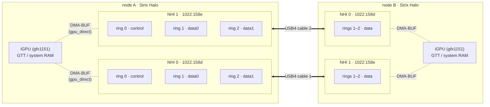
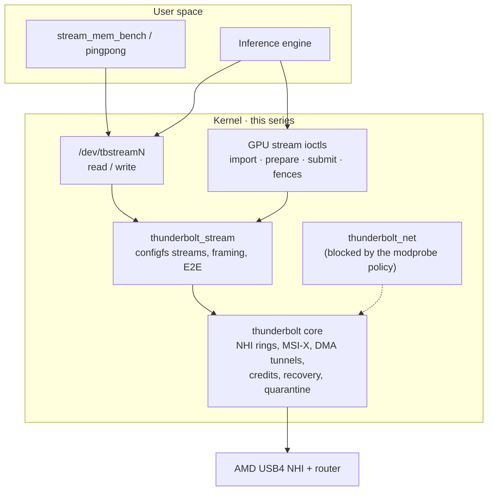
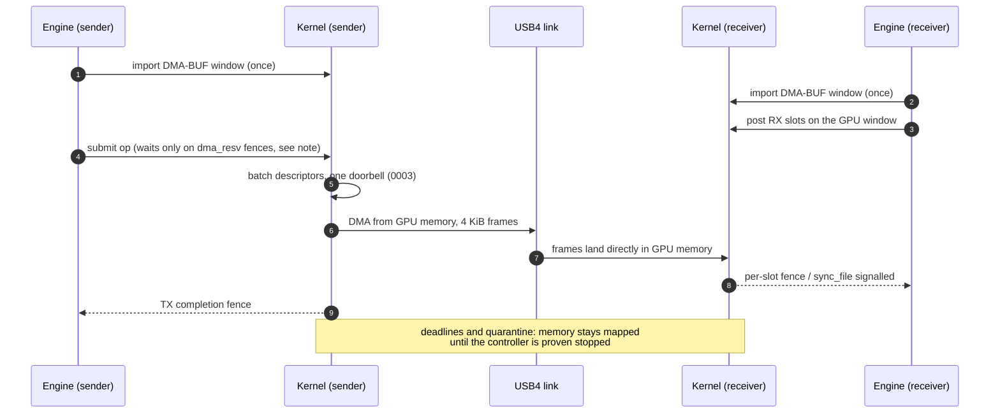

# Strix Halo USB4 driver

A Linux kernel patch series that turns the native AMD USB4 host controllers of
two **AMD Ryzen AI Max+ 395 ("Strix Halo")** machines into a direct DMA
interconnect for distributed LLM inference:

- **USB4STREAM character devices** (`/dev/tbstreamN`) for host memory, created
  through configfs, with batched submission, NAPI-style RX completion and
  per-stream latency controls;
- a **DMA-BUF GPU stream extension** (experimental UAPI
  `linux/strix_gpu_stream.h`) that moves data between the two iGPUs' memory
  without staging through TCP, with bounded queues, `sync_file` fences and
  fail-closed recovery;
- lifecycle, teardown and recovery fixes for the AMD USB4 NHI found while
  running the above on real hardware.

It is developed for the [Strix Halo inference engine](https://github.com/hyukudan/strix-halo-engine-lab)
and [TensorMeld](https://github.com/hyukudan/tensormeld), but the stream
devices are usable on their own. It is experimental, out-of-tree work: not
submitted upstream, tested on one pair of machines.

The series applies to Linux `72d3fcf802c45d00b300f25b848a93c3a2bd7c7e`
(**7.3-rc5**). The **48 stable patches** in [`patches/series`](patches/series)
(0001–0048) are the driver and the default install path. Three **experimental**
patches in [`patches/experimental/`](patches/experimental/) (0049–0051) apply on
top of them. Only 0051 has been measured on hardware, during one measurement
window; the stable module was restored afterwards. `overlay/` is an immutable capture
of the original source (pristine + 0001) and is *not* the current driver on its
own. Changes per release: [CHANGELOG.md](CHANGELOG.md).

## At a glance

**Purpose:** Connect two AMD Strix Halo Linux machines with low-overhead USB4 data exchange for distributed inference. This is a **research kernel patch series**, not a generic USB4 replacement driver or a plug-and-play networking product.

| Question | Answer |
|---|---|
| What does it provide? | USB4 stream character devices, an experimental DMA-BUF GPU-direct path, and AMD USB4 controller lifecycle/recovery fixes. |
| What does it replace? | The inference application's bulk/activation exchange path in the tested topology; it does **not** turn two GPUs into a single shared-memory GPU. |
| Where was it tested? | One physical pair of Ryzen AI Max+ 395 machines, with the exact kernel baseline and cable conditions described below. |
| Is it upstream? | No. The patches are out of tree and tied to a specific Linux commit. |
| Which patches are installed by default? | Only [the stable series](patches/series); patches under [experimental](patches/experimental/) must not be treated as hardware-qualified. |
| How do I reproduce it safely? | Read [Deployment and safety](#deployment-and-safety), then [Install and test](docs/INSTALL-AND-TEST.md) and [Benchmarks](docs/BENCHMARKS.md). |

**Reading the measurements:** Bulk throughput, a single GPU-direct ring, small-message latency and end-to-end inference exchange overhead measure **different workloads**. Do not compare them as if they were one interchangeable benchmark. Where a measurement is not yet available, no result is implied. Figures apply to the stated hardware, stream count, directionality and driver configuration—not arbitrary USB4 PCs.

## Getting started safely

**Do not install these kernel changes on an everyday workstation.** They are tested on a specific pair of machines and pinned Linux kernel, and require a separate build/rollback plan. The repository does not provide a generic package installer.

1. Read [tested hardware](#tested-hardware), [deployment and safety](#deployment-and-safety) and the complete [install-and-test guide](docs/INSTALL-AND-TEST.md).
2. Obtain the **exact** kernel commit `72d3fcf802c45d00b300f25b848a93c3a2bd7c7e`, then apply the default [stable series](patches/series) using `tools/apply-series.sh`; do **not** enable experimental patches for initial deployment.
3. Build a kernel with a **new, unique local version**, matching module configuration and a verified rollback kernel. The canonical commands are in [Build and install](#build-and-install).
4. After booting the test kernel on both nodes, inspect controller/ring topology before creating streams:

```bash
python3 tools/usb4_diagnose.py --require-budget
python3 tools/lab/usb4stream_describe.py --logs --summary
```

Use the complete [install-and-test guide](docs/INSTALL-AND-TEST.md) for stream setup, two-host verification, safe teardown and recovery. GPU-direct DMA requires the documented kernel and userspace setup; a device appearing under `/dev/tbstreamN` alone does **not** establish correct GPU-direct operation. Reproduce throughput and latency with [the benchmark protocol](docs/BENCHMARKS.md), recording cables, ring counts, transfer direction and streams.

## Highlights

- **~37 Gb/s per direction** sustained over two USB4 40 Gb/s cables with four
  parallel streams, both directions at once; ~34 Gb/s inside the inference
  engine for large pipelined transfers
  ([Measured performance](#measured-performance)).
- **GPU-to-GPU DMA:** the USB4 controller reads and writes iGPU memory directly
  through imported DMA-BUFs. No CPU copy, every byte verified.
- **Path chosen per message class:** per-layer decode exchanges, speculative
  verify windows, batched decode and prefill activations each take the host or
  GPU-direct path that is fastest for their size
  ([Routing per message class](#routing-per-message-class)).
- **Low latency when needed:** NAPI-style hybrid RX completion, busy polling
  and per-stream IRQ placement; 8.35 µs round trip for 64 B with interrupts on.
- **Built for real inference schedules** (measured with the engine's exchange
  module on two-node token replays, exact outputs):
  - MiniMax-class decode: exchange overhead **2.91 → 1.89 ms per token
    (−35 %)** with deferred checksums, an in-kernel GPU wait and
    producer-published buffers;
  - eight concurrent users: exchange time per step **12.55 → 7.71 ms (−38 %)**;
    one host poller plus a device gate replaced per-stream polling
    (17.80 → 7.80 ms at that point);
  - receive buffers posted ahead: long stalls go from **9–15 per 3,000
    exchanges to none**.
- **Exact by design:** no lossy compression on the wire; models produce the
  same tokens as without the interconnect.
- **Fail-closed lifecycle:** controller group reset and recovery, live session
  recovery, bounded teardown that revokes DMA before releasing a GPU context,
  and an audited patch series ([Verification](#verification)).

## Contents

- [Highlights](#highlights)
- [Status](#status)
- [Tested hardware](#tested-hardware)
- [Architecture](#architecture)
- [Measured performance](#measured-performance)
- [Patches](#patches)
- [Verification](#verification)
- [Build and install](#build-and-install)
- [Runtime configuration](#runtime-configuration)
- [Limitations](#limitations)
- [Deployment and safety](#deployment-and-safety)
- [Repository layout](#repository-layout)
- [Documentation](#documentation)
- [Licence](#licence)

## Status

As of 2026-10-25.

| Part | Patches | Status | On hardware |
|---|---|---|---|
| Stable series | 0001–0048, [`patches/series`](patches/series) | **Stable**, default install path. 0047 and 0048 are opt-in and off by default | The `thunderbolt_stream` module loaded on both lab machines since 2026-10-23 is the 0001–0048 build: rebuilding this tree reproduces its srcversion `3A05C2B1A13ABAEF9B767EF` |
| Bounded RX poll window | 0049, [`patches/experimental/`](patches/experimental/) | **Experimental** | Built (core and stream modules together) and CPU-tested; not installed, not measured |
| Paced RX descriptor polls | 0050, same directory | **Experimental** | Built (stream module) and CPU-tested; not installed, not measured |
| TX memory-path experiments | 0051, same directory | **Experimental** | Measured 2026-10-25 on one Gen3 host ring: cache-bypassing copies −15 %, 1024-byte TX frames +8.5 % (send only, a candidate, not a default); not installed by default |

What each experimental patch still needs is listed under
[Experimental patches](#experimental-patches).

## Tested hardware

| Item | Value |
|---|---|
| Machines | 2 × BOSGAME M5 (Sixunited AXB35-02 board, AMI BIOS 3.11, 2026-05-08), AMD Ryzen AI Max+ 395, 128 GB |
| USB4 host routers | AMD `1022:158d` and `1022:158e` (one per USB4 port), Parade retimers `1da0:8833`; USB4 v1 (no 80 Gb/s) |
| Cabling | Two USB4 40 Gb/s cables, each an independent link between one controller on each machine |
| Negotiated link | Gen3 × 2 (40 Gb/s per direction) per cable. In the 2026-10-22 measurements one cable trained Gen2 × 2 (20 Gb/s): one machine's second port advertised no Gen3 support |
| NHI rings | `hop_count` = 3 on all four NHIs: ring 0 is control, **2 data ring pairs per controller** |
| Kernels | Built as `7.3.0-rc5-strix-gpu-bosgame-<id>`; each build has its own identity |

## Architecture

### Topology



The diagram shows a crossed cabling (front port of one machine to the rear
port of the other). Any port pairing works; what matters is knowing which
endpoint pairs with which. With this cabling NHI 0 on node A talks to NHI 1 on
node B and vice versa, so `/dev/tbstream0` on node A pairs with
`/dev/tbstream1` on node B, and so on. Domain numbers, and therefore the
`D-R.S` service names, are assigned at probe time: if one controller fails to
probe, the other one becomes domain 0 and the pairing changes. Rely on the
topology report, not on fixed indexes: `usb4stream-describe`
([`tools/lab/usb4stream_describe.py`](tools/lab/usb4stream_describe.py)) writes
each stream's controller, link speed and lanes, remote host, hop IDs and cable,
and `--merge` combines the reports of both hosts into the cable pairing and the
`tbstreamN` pairs ([docs/INSTALL-AND-TEST.md](docs/INSTALL-AND-TEST.md#5-lab-streams-and-the-layout-file)).

Each controller has three ring pairs and ring 0 carries the control channel, so
each cable has **two data ring pairs**: four USB4STREAM devices per machine
(`/dev/tbstream0..3`).

### Software stack



### GPU-to-GPU transfer



**Synchronization contract with HIP/ROCm.** SUBMIT and RX_REPOST wait only for
fences published in the DMA-BUF's `dma_resv` (DRM command submission, Vulkan
implicit sync). HIP kernels run on KFD user queues that publish no such fence,
so with HIP memory the kernel cannot see GPU work: the application **must**
finish the producer (for example `hipStreamSynchronize`/`hipEventSynchronize`,
or a system-scope release flag the CPU observes) before SUBMIT, and finish every
consumer of an RX window before RX_REPOST or PREPARE of that slot. Otherwise the
DMA reads data the GPU has not written yet, or overwrites data it is still
reading, with no error. Post the RX of exchange k+1 before the TX of exchange k:
an RX ring left empty on the peer caused 100–200 ms TX stalls
([docs/GPU-COMPLETION-POLLING.md](docs/GPU-COMPLETION-POLLING.md#0043-txrx-progress-stall-detector)).

## Measured performance

All figures are lab observations on the machines above, payload verified by the
receiver, without CPU latency QoS unless stated. Their raw logs are not in this
repository; [docs/BENCHMARKS.md](docs/BENCHMARKS.md) lists what a reproducible
measurement must record. Do not mix percentiles of different runs.

### Current figures

Both machines, `thunderbolt_stream` 0001–0048, four host streams (one per data
ring: cable A trained Gen3 × 2, cable B Gen2 × 2), every byte verified.
The 0051 row used 0001–0048 + experimental 0051 for one measurement window;
the stable module was restored afterwards.

| Measurement | Date and conditions | Result |
|---|---|---|
| Health check: all four streams at once, both directions | 2026-10-23, lab stream settings (interrupts, `throttling=8192`, `contig_buffers=0`), 2 GiB per stream | Gen3 cable **11.22–11.37 Gb/s per stream**, Gen2 cable **9.46–9.48 Gb/s per stream**; no CRC errors, no damaged frames |
| One Gen3 host ring, interrupt RX, `contig_buffers=3` | 2026-10-23, long transfers, sender and receiver pinned | **12.11–12.23 Gb/s** |
| Same ring, RX-only polling (0047 `rx_busy_poll=1`) | 2026-10-23, same session | 11.17–11.21 Gb/s (−7 to −9 %, receiver side only) |
| 0048 batch budgets (RX 64, or RX and TX 64) | 2026-10-23, four streams, `contig_buffers=3`, sum of the per-stream rates | unchanged: 42.62 Gb/s with and without |
| One Gen3 host ring, TX memory-path experiments (0051) | 2026-10-25, one stream, A/B/A × 3 | Default 9.18 Gb/s send; non-temporal or evicting copy −15 %; `clwb` −0.8 %; 1024-byte frames 10.00 Gb/s (+8.5 %), 2048-byte +5.2 % (send only, a candidate, not a default); sender TX ring always full |

Through both cables with both directions busy, the measured common-window
throughput is **~37 Gb/s per direction** (36.9–37.1 Gb/s, 2026-10-22, see
below): the Gen2 cable finishes last, so adding per-stream rates overstates it.

### Theoretical ceiling per direction

| Link | Raw | After 128b/132b, RS-FEC and packet headers |
|---|---:|---:|
| Gen3 × 2 | 40 Gb/s | ≈ 37 Gb/s (4.6 GB/s) |
| Gen2 × 2 | 20 Gb/s | ≈ 18.5–19 Gb/s |

### Bandwidth, host memory

[`tools/stream_mem_bench.c`](tools/stream_mem_bench.c), one process per stream,
1 MiB writes, every byte checked against a position-dependent pattern.

| Configuration | Date, links, patches | Result |
|---|---|---|
| 1 stream (one host ring pair) | 2026-10-17 and 2026-10-22, Gen2 or Gen3 | 8.8–11 Gb/s; the same on Gen2 and Gen3 links |
| 2 streams, one Gen3 cable | 2026-10-22, 0001–0043 | 22.1 Gb/s (11.05 + 11.05) |
| 2 streams, one Gen2 cable | 2026-10-22, 0001–0043 | 18.9 Gb/s (link-bound) |
| 4 streams, 2 cables, one direction | 2026-10-17, both cables Gen3, 0001–0010 | 42.6–44.3 Gb/s (~5.4 GB/s) |
| 4 streams, 2 cables, one direction | 2026-10-22, Gen3 + Gen2, 0001–0043 | 41.0 Gb/s (sum of per-stream rates); 36.5–37.7 Gb/s common window |
| 4 streams, 2 cables, both directions | 2026-10-22, Gen3 + Gen2, 0001–0043 | 39.8 Gb/s per direction as a sum of per-stream rates; **36.9–37.1 Gb/s per direction** over the common window (bytes / (last end − first start)) |
| One Gen3 cable (two rings), common window | 2026-10-22/23, 0001–0045 | 22.33 / 22.72 Gb/s send / receive; 24.16 / 24.26 with `contig_buffers=3`. Gen2 cable: 18.93–18.95 Gb/s |
| **0045 `contig_buffers=3`**, one Gen3 host ring | 2026-10-22/23, 0001–0045, interleaved A/B, 3 repetitions, 4 GiB per stream | **12.1 Gb/s** vs 11.2–11.4 without (+7–8 %); 4 streams both ways ~79 → ~85 Gb/s total as a sum of per-stream rates; the common window stays ~37 Gb/s per direction (Gen2-bound) |

The per-ring rate, not the link, is the limit for host memory: each NHI has
only two data rings and a host ring moves 9–12 Gb/s regardless of link
generation. A single GPU-direct ring measures the same ~12 Gb/s as a Gen3 host
ring with contiguous buffers (0045), so GPU versus host memory is not the
limit; what costs is how host memory is presented to the controller (4 KiB
frame buffers mapped one by one through a translating IOMMU cost ~7–10 %),
which is what 0045 addresses.
The A/B/A tests that ruled out credits, end-to-end flow control, interrupt
moderation, PCIe read request size, clocks, platform power mode and CLx are in
[docs/BENCHMARKS.md](docs/BENCHMARKS.md#ruled-out-for-the-per-ring-rate).

### Bandwidth, GPU-direct

2026-10-22, 0001–0043, engine probe over DMA-BUF windows with `gpu_poll=1`,
every byte checked on the GPU. Two GPU-direct rings move **~22.8 Gb/s per
direction** (16 MB in 5.88 ms) and saturate at ~22.5–23 Gb/s per direction for
messages ≥ 4 MB; a single GPU-direct ring measures **12.1 Gb/s**, the same as a
Gen3 host ring with contiguous buffers (0045). An earlier version of this page
quoted 22.8 Gb/s for one ring; that run used two rings. For small messages the GPU path costs 45–50 µs
per 20 KB exchange (including the engine's own copies and synchronization)
versus 30–40 µs through host streams; it wins from ~64 KB.

### Latency

Round trip, one stream, [`tools/pingpong.c`](tools/pingpong.c), 2 000 samples
after 200 warm-up, both ends verify the full payload (2026-10-17, 0001–0010):

| Configuration | 64 B | 4 KiB | 64 KiB |
|---|---:|---:|---:|
| Interrupts, `throttling=8192` (default) | 16–17 µs | 25–26 µs | 148 µs |
| Interrupts, `throttling=0` | 16.0 µs | 23.7 µs | 142 µs |
| `busy_poll=1` (interrupts off) | 8.2 µs | 15.7 µs | 137 µs |
| **`rx_napi=1 spin_us=25`** (0010, interrupts on) | **8.35 µs** | **15.9 µs** | **118 µs** |

Symmetric exchange of 20 KB over 4 streams (both nodes send and receive), raw
streams without an engine, p50 (2026-10-22/23, 0001–0043 for the default row,
0001–0045 for the others; caller and IRQs pinned, no CPU latency QoS):

| Path | Back to back | After 300 µs idle |
|---|---:|---:|
| Interrupts (default) | 18–22 µs | 45–60 µs (mean 70–90 µs, tails ~220 µs) |
| `rx_napi=1`, IRQ on a fixed CPU | 24 µs | 40 µs |
| `busy_poll=1` (no data interrupts, non-blocking I/O) | 10 µs | 27 µs |

Through the inference engine's host path (2026-10-22, series 0001–0043 / 0001–0045 with 0044/0045 off, 4 streams,
the engine's copies, CRC and synchronization included): a 20 KB exchange takes
**35.5 µs p50 back to back** and ~128 µs p50 after 300 µs idle. Large messages
pipelined in 1 MiB chunks with the CRC overlapped (an engine option): 13 MiB in
3.19 ms and 21 MiB in 5.15 ms, 34.1–34.2 Gb/s per direction.

After an idle gap the cost is the wake-up chain (interrupt → completion work →
reader, each possibly leaving a deep C-state), not the cable; it happens even
when the user thread never sleeps. `busy_poll` removes most of it at the price
of a spinning core. 0044 was an attempt to shorten that chain and made it worse
(see [Patches](#patches)).

### Routing per message class

`gpu_direct` is a per-stream configfs attribute, so each of the four streams
can be a host stream or a GPU-direct stream. The two-node DeepSeek V4.1 engine
picks the path per message by size:

| Message class | Typical size | Production layout: 4 host streams | Measured alternative: per cable, data0 host + data1 GPU-direct (`gpu_poll=1`) |
|---|---|---|---|
| Decode exchange, 1 stream (per layer, latency-bound) | ~20 KB, ≤ 64 KiB | host, sent eagerly in one duplex poll loop | host (2 streams): decode **−1 %** |
| Verify window, 6 rows (speculative decode) | ~120 KB | host, striped over 4 streams | GPU-direct (2 rings): **+2.9 %** (63.53 → 61.71 ms per window) |
| Batched decode, 8 streams | ~160 KB | host, striped | GPU-direct: equal |
| Prefill activations (bulk) | MB | host, striped | GPU-direct ≤ 1 MiB, larger messages split over both paths: 8K prefill **+1.6 %** (721.7 → 733.3 tok/s) |
| Server, 2 / 4 / 8 concurrent requests | mixed | host | **+5 / +7 / +4 %**; 8K time to first token after 40 s idle 17.35 → 15.69 s |

Measured 2026-10-22 (driver series before 0047) with the same engine binary and
kernel in both layouts, every result bit-identical between layouts. The
same layout with `latency_qos_us=0` was slower everywhere. Production stays on
four host streams; the mixed layout has not been through the production gates.
A full per-stream matrix (one direct and one host stream on each cable, every
combination per message class) has **not been measured yet**.

What the engines get from the link today, all on the stable series and four
host streams (engine pre-release builds of 2026-10-24, every run bit-identical
to its reference): DeepSeek V4.1 Flash split across both machines decodes one
stream at **32.7 tok/s** (30.6 ms per token, about 81 exchanges per decode step), eight
streams at **101.3 tok/s** aggregate, and prefills 8K tokens in 10.78 s.
Details and conditions:
[engine performance page](https://github.com/hyukudan/strix-halo-engine-lab/blob/main/docs/performance.md).

## Patches

Status: **default** = active without any parameter; **opt-in** = off until a
module parameter, configfs attribute or flag enables it; **diagnostic** = no
behaviour change.

| Patch | Status | Purpose |
|---|---|---|
| `0001-usb4-current-source` | default | Captured baseline: USB4STREAM configfs streams, the experimental GPU DMA-BUF UAPI (`linux/strix_gpu_stream.h`), GPU ring framing and slot reuse, aligned imported windows, runtime DMA credits, selected core teardown/notification reverts (the upstream AMD DMA-teardown reset is removed), posted MSI-X acknowledgement and ring-arm fixes. |
| `0002-credit-accounting-and-link-diagnostics` | default | Validated `dma_credits` (1..127, applies to new tunnels), guards against inconsistent firmware credit values, shared RX credit budget, MSI-X interrupt clear selected from the full TX/RX index. |
| `0003-batch-gpu-ring-submission` | default | Publishes a batch of GPU descriptors with one `dma_wmb()` and a single doorbell write. |
| `0004-fence-and-stop-lifetime` | default | Fence and ring-stop lifetime guards. |
| `0005-gpu-queues-fences-and-session-recovery` | default | Bounded GPU operation queues (up to 8 per direction), per-slot fences exported as `sync_file`, fail-closed session recovery. |
| `0006-dma-progress-idle-reset-and-quarantine-reaping` | default | DMA progress independent of the ioctl mutex, finite DMA deadlines, exclusive idle controller reset restricted to known AMD USB4 routers, quarantine of DMA-visible memory until stop is proven. |
| `0007-external-dependency-errors` | default | Rejects failed external GPU dependencies and keeps readiness fences across retries. |
| `0008-detached-quarantine-and-notification-lifecycle` | default | Detached-peer quarantine reclamation by the original owner, bounded XDomain property notifications. |
| `0009-domain-retirement-and-cooperative-controller-recovery` | default | Safe retirement of quiescent contexts with old FDs still open, explicit group reset for up to 16 owner-held GPU FDs, optional cooperative USB4NET close/reset/reopen. |
| `0010-stream-rx-napi-hybrid-completion` | opt-in (`rx_napi`) | NAPI-style RX completion: the IRQ wakes the reader, which reaps frames itself and polls for up to `spin_us` before re-arming the interrupt. |
| `0011-stream-per-stream-napi-and-irq-steering` | opt-in | Per-stream configfs `rx_napi`, `spin_us` and `irq_cpu`. |
| `0012-cm-unlink-tunnels-on-stop` | default | `tb_stop()` unlinks every tunnel it frees (use-after-free on reboot/unbind with an armed GPU session). |
| `0013-bounded-domain-release-and-dma-revocation` | default | A GPU context that cannot prove its DMA stopped no longer hangs reboot/unbind: bus mastering is revoked and verified, or the context is abandoned; the domain wait is bounded. |
| `0014-stream-open-error-path-and-frame-arrays` | default | A failed open no longer leaves the tunnel behind (later opens failed with `ENOMEM`); frame arrays use `kvcalloc`. |
| `0015-stream-spin-outside-device-mutex-and-irq-restore` | default | `spin_us` polling runs without the device mutex; IRQ affinity is restored when the stream stops. |
| `0016-gpu-kernel-validated-terminal-frame` | opt-in (flag) | `SGU_PREPARE_TERMINAL_HEADER`: kernel-built and kernel-validated terminal header (length, epoch, sequence, size, slot). |
| `0017-stream-detach-ram-rings-and-domain-xdomain-teardown` | default | Open RAM-ring streams stop when their service goes away; domain removal unregisters XDomains and services before `tb_stop()`; bounded wait on a failed probe; host interface reset at probe on AMD v1 NHIs. |
| `0018-amd-teardown-interface-reset-when-idle` | default (`teardown_reset`) | After a DMA path teardown, reset an idle AMD v1 host interface (recovers the documented TX hang), bounded and logged. |
| `0019-stream-open-bounded-wait-for-peer` | default | `open()` fails fast without domain or XDomain and otherwise waits up to `open_timeout_ms` for the peer. |
| `0020-nhi-shutdown-releases-ring-interrupts` | default | `nhi_shutdown()` frees the vectors and cancels the work of rings still registered. |
| `0021-stream-device-state-under-lock` | default | Stream validation only under the device mutex (use-after-free race with detach). |
| `0022-stream-resume-failure-fails-open-files` | default | A stream that cannot restart on resume fails its open files instead of leaving NULL rings. |
| `0023-stream-rx-counters-before-posting` | default | RX counters reset before the buffers are posted. |
| `0024-dma-revoke-proves-relaxed-ordering-off` | default | The revocation proof also requires Relaxed Ordering off and a valid register read. |
| `0025-stream-damaged-rx-frame-fails-read` | default | A frame with a CRC error or overrun makes `read()` return `EIO` instead of data. |
| `0026-stream-close-bounded-wait-for-tx-slot` | default | Close waits up to 500 ms for a TX slot for the CLOSE frame. |
| `0027-stream-partial-io-accounting` | default | Partial `read()`/`write()` accounting and zero-length I/O. |
| `0028-stream-close-does-not-flush-rx` | default | Close no longer waits for posted RX buffers that never complete. |
| `0029-amd-teardown-reset-pending-until-idle` | default | A 0018 reset stays pending per NHI until the NHI is free. |
| `0030-stream-spin-us-parameter-bounded` | default | The `spin_us` module parameter is bounded to 1000 µs. |
| `0031-gpu-nonblock-submit-does-not-sleep-on-mutex` | default | `O_NONBLOCK` SUBMIT/RX_REPOST return `EAGAIN` instead of sleeping on the device mutex. |
| `0032-kernel-doc-stream-tbnet-cm-ops-members` | default | Kernel-doc for members `W=1` reported. No code change. |
| `0033-xdomain-lane-bonding-result-checked` | default | XDomain lane bonding checks its result and retries at most twice. |
| `0034-host-router-reset-result-checked` | default | `tb_start()` checks the host router reset. |
| `0035-opt-in-gen3-retrain` | opt-in (`gen3_retrain`) | Bounded port reset to bring a new XDomain link from Gen2 to Gen3 when every side advertises Gen3. |
| `0036-gpu-nonblock-submit-does-not-sleep-on-dma-lock` | default | `O_NONBLOCK` submissions also only try the DMA submission lock. |
| `0037-stream-damaged-close-is-an-error` | default | A damaged CLOSE frame gives `EIO`, not end of file. |
| `0038-teardown-reset-pending-survives-requests-contention-suspend` | default | Request generations for the pending reset; retried under contention; re-armed on resume. |
| `0039-gen3-retrain-serialized-and-exclusive` | default | The Gen3 retrain takes the domain lock, keeps the NHI free of data rings and is vetoed by any tunnel. |
| `0040-completion-path-timing` | diagnostic | Ring and GPU operation timing from SUBMIT to EVENT, read through configfs `gpu_timing`. |
| `0041-gpu-opt-in-polled-completion` | opt-in (`gpu_poll`) | GPU sessions complete by polling from `SGU_IOC_EVENT` with a 1 ms watchdog fallback, without interrupts. |
| `0042-stream-opt-in-cpu-latency-qos` | opt-in (`latency_qos_us`) | Holds a `cpu_latency_qos` request while a stream's or GPU session's rings run. |
| `0043-gpu-tx-progress-stall-detector` | diagnostic (`gpu_stall_ms`) | Counts GPU stall episodes (operation pending, no frame completed for more than `gpu_stall_ms`) with the ring state. |
| `0044-nhi-opt-in-per-cpu-highpri-completion-work` | opt-in, **measured: harmful** | `thunderbolt.dma_wq_percpu` runs ring completion work on the interrupt's CPU in a per-CPU high-priority workqueue. Measured 2026-10-22 on both nodes: ms tails after idle (20 KB p99 0.23 → 2.9 ms; the bound worker can wait ~2.5 ms behind a busy thread on its CPU), a slower back-to-back exchange (18 → 32 µs p50) and a +3.7 % slower two-node decode step. **Keep it off.** |
| `0045-stream-opt-in-contiguous-dma-buffers` | opt-in (`contig_buffers`) | Host stream frame buffers carved from naturally aligned blocks of up to 2 MiB, each mapped once (bit 0 TX, bit 1 RX). Measured +7–8 % per Gen3 host ring; Gen2 rings are link-bound; GPU results bitwise identical. |
| `0046-host-completion-latency-tracepoints` | diagnostic | `thunderbolt:tb_latency` tracepoint (IRQ, work, reap, NAPI, wake, doorbell stages), behind a static key: [docs/host-latency-tracing.md](docs/host-latency-tracing.md). |
| `0047-host-rx-only-polled-completion` | opt-in (`rx_busy_poll`) | Host streams: RX without interrupts, reaped inline by the reader; TX keeps its interrupts. Rejected together with `gpu_direct`. Measured 2026-10-23: one Gen3 ring receives 7–9 % less than with interrupt RX; its latency effect has not been measured on its own: [docs/host-rx-only-polling.md](docs/host-rx-only-polling.md). |
| `0048-host-opt-in-descriptor-batching` | opt-in (`rx_repost_batch`, `tx_submit_batch`) | Host streams: RX reposts and TX submissions published in bounded batches (up to 64 frames, one doorbell). Measured 2026-10-23: no bandwidth change, because an RX batch never fills; kept off: [docs/host-descriptor-batching.md](docs/host-descriptor-batching.md). |

### Experimental patches

[`patches/experimental/series`](patches/experimental/series) lists 0049–0051.
They apply only on top of 0001–0048 and only in this order
(`tools/apply-series.sh --with-experimental`). Every new setting defaults to
off, and with the defaults the code paths are unchanged. 0049 and 0050 have not
been installed or measured on hardware; 0051 was loaded for one measurement
window (results in its row).

| Patch | Adds | Built and tested | Still to measure |
|---|---|---|---|
| `0049-host-bounded-rx-poll-window` | Bounded RX polling window (poll lease): configfs `rx_window_bytes` / `rx_window_us` and BEGIN/END ioctls in the new UAPI `linux/strix_host_stream.h`. BEGIN masks one RX ring's interrupt while the reader polls; END or a hard timer (≤ 10 ms) unmasks it. Changes the core (`tb_ring` layout, new exports): core and stream modules must be rebuilt and installed together, which means a kernel change | CPU tests that run the actual core and stream functions under ASan/UBSan (51 cases). [docs/host-rx-poll-window.md](docs/host-rx-poll-window.md) | Interrupts and BEGIN/END cost per exchange; decode with one window per decode step against interrupts and against RX-only polling, with bit-exact model gates |
| `0050-host-paced-rx-descriptor-polls` | `rx_poll_pace_ns` (0–10000): after an empty RX poll, leave the descriptor ring alone that long. Polled RX only (`busy_poll` / `rx_busy_poll`) | Stream module only; CPU tests. [docs/host-rx-poll-pace.md](docs/host-rx-poll-pace.md) | Bandwidth and latency against unpaced RX-only polling and interrupt RX, interleaved: does it recover the 7–9 % polled-mode loss, and at what latency cost |
| `0051-host-tx-memory-path-experiments` | Module parameters `tx_copy` (cached / non-temporal / write back / write back and evict), `tx_frame_bytes` (256–4096) and `tx_no_snoop` (needs the core flag `RING_FLAG_NO_SNOOP`) | Stream module (without `tx_no_snoop`); CPU tests. [docs/host-tx-memory-path.md](docs/host-tx-memory-path.md) | Measured 2026-10-25, one Gen3 host ring, A/B/A × 3: default 9.18 Gb/s send; non-temporal / `clflushopt` −15 %, `clwb` −0.8 %; 1024-byte frames +8.5 %, 2048-byte +5.2 % (send only, a candidate, not a default). The sender's TX ring stayed full. `tx_copy` 1 and 3 stay off (slower reads from DRAM), 2 stays off (neutral), 0 stays the default. Still to measure for smaller frames: receive direction, four streams at once, the engines' message sizes and interaction with `contig_buffers`; `tx_no_snoop` is not measured (needs the core flag). 0051 stays experimental |

Design rule throughout: a timeout, process exit, failed MMIO read or missing
PCI device is **never** treated as proof that DMA has stopped. Memory the
controller may still write to is kept until stop is proven.

Upstream backport, kept outside the series:
[`patches/kernel-backports/`](patches/kernel-backports/) contains the v7.3-rc7
fix `e6895021a328` *drm/amdkfd: fix dma_buf reference leak in
get_dmabuf_info* (Cc: stable), which affects the DMA-BUF import path. It applies
cleanly on 7.3-rc5.

## Verification

| Check | Result |
|---|---|
| Series applies to pristine 7.3-rc5 | `tools/apply-series.sh`: all 48 stable patches; with `--with-experimental` all 51 |
| `prepare_overlay.py` vs applying the series | byte-identical |
| Offline unit tests | see [Build and install](#build-and-install); CI runs them on every push against the stable tree and against the tree with the experimental patches. 2026-10-24: stable tree 314 run, OK (10 skipped: 9 experimental-only cases and one optional bundle check); with 0049–0051 314 run, OK (2 skipped) |
| Modules with `W=1`, `USB4_GPU_STREAM=y` and `=n` | 0 warnings, 0 errors; `tools/check_build_log.py` makes any diagnostic in this series' files fatal |
| On hardware | 0001–0042 has been the default kernel of both machines since 2026-10-21 (distributed inference over host streams and GPU-direct); 0001–0045 booted since 2026-10-22 with 0044/0045 off unless stated; the 0001–0048 stream module is loaded on both since 2026-10-23, with 0047/0048 off. 0049–0050: not on hardware; 0051 loaded for one measurement window on 2026-10-25 (stable module restored) |
| Link negotiation | Gen3 × 2 kept across module reloads and controller resets; one port trained Gen2 (see [Limitations](#limitations)) |
| GPU-to-GPU on hardware | one-way and full duplex with slot reuse (up to 8 operations per direction), live session recovery, controller group reset with and without USB4NET: every window verified |
| Stream open/close stress | 80 cycles across all 4 streams and both directions, zero failures, zero kernel warnings |

## Build and install

Full instructions: [BUILD.md](BUILD.md) and
[docs/INSTALL-AND-TEST.md](docs/INSTALL-AND-TEST.md).

### Offline tests

The builder needs a pristine checkout of the pinned kernel. It validates `tb.c`,
`tb.h` and USB4NET `main.c` from it against `provenance/lifecycle-base.json`.

```sh
git init -q ../linux-pinned
git -C ../linux-pinned fetch --depth 1 https://github.com/torvalds/linux.git \
    72d3fcf802c45d00b300f25b848a93c3a2bd7c7e
git -C ../linux-pinned checkout -q FETCH_HEAD

python3 tools/prepare_overlay.py audited-overlay --kernel-source ../linux-pinned
USB4_SOURCE_TREE="$PWD/audited-overlay" USB4_KERNEL_SOURCE="$PWD/../linux-pinned" \
    python3 -m unittest discover -s tests -v
```

Requires Python 3, Git and a C compiler with AddressSanitizer and
UndefinedBehaviorSanitizer. The tests compile real driver functions against
mocked kernel, HIP, MMIO and DMA boundaries; they do not emulate the NHI. The
three end-to-end `test_stream_bench` runner tests read the machine's live ring
budget and fail on a host whose rings are in use.

### Apply the series and build

`tools/apply-series.sh` is the canonical way to apply the series: it validates
the series file, checks each patch before applying it and stops with a non-zero
status at the first failure (start again from a pristine copy).

```sh
tools/apply-series.sh --with-backports ../linux-pinned   # backports optional, recommended
cd ../linux-pinned
cp /boot/config-"$(uname -r)" .config
scripts/kconfig/merge_config.sh -m .config "$OLDPWD/config/usb4-gpu.fragment"
scripts/config --set-str LOCALVERSION "-strix-gpu-bosgame-$(date +%Y%m%d)a"
make olddefconfig
python3 "$OLDPWD/tools/check_kconfig.py" .config --kernelrelease "$(make -s kernelrelease)"
make -j"$(nproc)" W=1
```

Add `--with-experimental` to also apply 0049–0051 on top. Not for production:
0049 changes the core module, so it needs a complete new kernel. 0049 and 0050
are not installed, not measured; 0051 was measured during one hardware window
and stays experimental.

The fragment's `LOCALVERSION` is a placeholder that `check_kconfig.py` rejects:
every build needs its own identity under `-strix-gpu-bosgame-`, so it never
reuses the module directory of an installed kernel. Loadable modules must match
the running kernel exactly (vermagic and MODVERSIONS CRCs): build them from the
same tree and configuration, or install a complete new kernel next to the
previous one ([docs/INSTALL-AND-TEST.md](docs/INSTALL-AND-TEST.md) section 1b).
[`tools/lab/`](tools/lab/) has the stream setup service, the modprobe policy
and the topology report.

## Runtime configuration

Streams are created in configfs under
`/sys/kernel/config/thunderbolt/stream/<service>/<name>/` and appear as
`/dev/tbstreamN`. The lab setup creates two streams per USB4 port:

| Attribute | Lab value | Notes |
|---|---|---|
| `ring_size` | 1024 | descriptors per ring |
| `throttling` | 8192 | interrupt moderation in ns; ~1 µs effect on latency, none on bandwidth |
| `busy_poll` | 0 | `1` cuts small-message latency but burns a core and rejects `poll(2)`; **rejected while `gpu_direct=1`** |
| `gpu_direct` | 0 | enables the DMA-BUF GPU path for that stream |
| `in_hopid` / `out_hopid` | -1 | auto allocation |
| `rx_napi` | -1 | 0011: per-stream override of the module parameter (-1/0/1); ignored on `gpu_direct` streams |
| `spin_us` | -1 | 0011: per-stream RX polling time, 0..1000 µs |
| `irq_cpu` | -1 | 0011: CPU for the stream's ring interrupts; restored on close. Ban these IRQs in irqbalance if the placement must hold |
| `latency_qos_us` | -1 | 0042: CPU latency limit while the rings run, 0..100000 µs; -1 follows the module parameter. A global QoS takes power budget from the rest of the machine |
| `gpu_poll` | -1 | 0041: GPU sessions complete by polling (1) or by interrupts (0); -1 follows the module parameter |
| `gpu_timing` | — | 0040/0043: completion-path timing and stall episodes; write anything to reset |
| `open_timeout_ms` | -1 | 0019: how long a blocking `open()` waits for the peer, 0..600000 ms |
| `rx_busy_poll` | 0 | 0047: host RX without interrupts, TX keeps them; rejects `poll(2)` like `busy_poll`; rejected while `gpu_direct=1` |
| `rx_repost_batch` / `tx_submit_batch` | 0 | 0048: batch budgets 0..64 frames; rejected while `gpu_direct=1` |
| `gpu_quarantine` (RO) / `gpu_recover` (WO) | — | quarantined GPU context; write `reap` or `reset` (CAP_SYS_ADMIN, no open FD) |

Module parameters:

| Parameter | Default | Notes |
|---|---|---|
| `thunderbolt.dma_credits` | 14 | the router accepts at most 32; no measurable effect on these machines |
| `thunderbolt.teardown_reset` | on | 0018/0029: reset an idle AMD v1 host interface after a DMA path teardown |
| `thunderbolt.gen3_retrain` | 0 | 0035: port resets allowed to bring a new XDomain link to Gen3 (at most 3) |
| `thunderbolt.dma_wq_percpu` | off | 0044: **measured harmful, keep off** |
| `thunderbolt_stream.rx_napi` | off | 0010: reader-side RX reaping for streams opened afterwards |
| `thunderbolt_stream.spin_us` | 0 | 0010: polling time before re-arming the RX interrupt; 25 measured best for 64 B–4 KiB round trips; at most 1000 |
| `thunderbolt_stream.gpu_dma_timeout_ms` / `gpu_standby_timeout_ms` | 30000 / 300000 | GPU DMA deadlines |
| `thunderbolt_stream.open_timeout_ms` | 30000 | 0019: default wait of a blocking `open()` for the peer |
| `thunderbolt_stream.gpu_poll` | off | 0041: polled completion for GPU sessions opened afterwards |
| `thunderbolt_stream.gpu_poll_budget` / `gpu_poll_fallback_ms` | 64 / 1 | 0041: frames per ring per collection; watchdog period while polling |
| `thunderbolt_stream.latency_qos_us` | -1 | 0042: CPU latency QoS while rings run; -1 none |
| `thunderbolt_stream.gpu_stall_ms` | 10 | 0043: stall episode threshold, diagnostics only; 0 off |
| `thunderbolt_stream.contig_buffers` | 0 | 0045: contiguous frame buffers for host streams opened afterwards; bit 0 TX, bit 1 RX |
| `thunderbolt_stream.gpu_reap_orphans` | — | 0013, write-only: `1` reaps quarantined GPU contexts whose configfs stream was removed |

The experimental settings (`rx_window_bytes`, `rx_window_us`, `rx_poll_pace_ns`,
`thunderbolt_stream.tx_copy`, `tx_frame_bytes`, `tx_no_snoop`) exist only with
`patches/experimental/` applied; see their documents.

`thunderbolt_net` is blocked in these kernels through the modprobe policy
[`tools/lab/usb4stream-dedicated.conf`](tools/lab/usb4stream-dedicated.conf)
(it only applies to `7.3.0-rc5-strix-gpu-bosgame-*`; stock kernels keep USB4
networking) so that both data ring pairs remain available to USB4STREAM.
`python3 tools/usb4_diagnose.py --require-budget` shows the ring consumers per
controller and fails if they exceed the budget or cannot be verified.
Diagnostics: `python3 tools/usb4_diagnose.py --logs` on both hosts (as root, add
`--registers` or `--lanecap` to compare sysfs with the lane adapter registers);
`python3 tools/lab/usb4stream_describe.py --logs --summary` for the cable
topology.

### Link status collector

`python3 tools/usb4_linkstat.py [--journal] [--cursor CURSOR]` prints one JSON
document per host for monitoring, without root and without touching a stream:
trained speed and lanes per direction of every link with a flag below the Gen3
x2 full rate (20 Gb/s per lane, two lanes), the published layout's streams with
their configured mode and two live checks (device node present, service bound
to `thunderbolt_stream`), the readable module parameters (write-only ones are
listed, never opened), the interrupt counts of each host interface split into
control and data vectors, and, with `--journal`, kernel evidence lines of the
running boot (host interface reset, reset pending, quarantine, leaked rings,
retained contexts, hop deactivation failures, CLOSE not sent) counted per kind.
Pass the report's `cursor` back with `--cursor` to read only newer entries; the
tool continues only from that exact entry and otherwise rescans the boot.
Stream devices are only `lstat()`ed, configfs and debugfs are never read, every
read is bounded and the run has one deadline (`--deadline`, 5 s).
`--self-check` verifies the parsers against a synthetic tree; `--root DIR`
reads an offline copy of `/sys`, `/proc` and `/run`.

## Limitations

- **Host-memory bandwidth is bounded per ring**, not by the link: 9–12 Gb/s per
  host ring and two data rings per NHI, so a Gen3 cable carries ~22–24 Gb/s of
  its ~37 Gb/s. A GPU-direct ring measures ~12.1 Gb/s, like a host ring with
  contiguous buffers; two reach ~23 Gb/s together. On 2026-10-25 the sender's
  TX ring stayed full while one ring moved 9.2 Gb/s, smaller TX frames helped
  and cache-bypassing copies hurt: the per-ring limit is the controller's TX
  read path, not software or the receiver.
- **Polled RX costs bandwidth on Gen3:** RX-only and full polling receive
  7–9 % less per Gen3 ring than interrupt RX (2026-10-23); Gen2 rings are
  link-bound and do not show it.
- **Small messages after idle** pay 45–90 µs of kernel wake-up chain per
  exchange with interrupts; only busy polling (a spinning core per stream)
  removes most of it. No module setting without a global CPU latency QoS moved
  it in our measurements.
- **RX CRC error after a DMA teardown:** after a DMA teardown on process exit,
  the next process can see an RX CRC error at its first exchange (probe). It is
  detected by the CRC and the run fails; no silent corruption. Seen three times
  between 2026-10-24 and 2026-10-25; under investigation.
- **Link training:** on the tested pair one rear port trained at Gen2 × 2,
  because that router advertised no Gen3 support for the second link; 0035 can
  retrain only when every side advertises Gen3. Check the link speed after every
  boot.
- **Experimental UAPI:** `linux/strix_gpu_stream.h` may change; the engine
  keeps a byte-identical copy and CI compares them.
- HIP work is invisible to the kernel's fence waits (see the synchronization
  contract above).
- One hardware pair, one board and BIOS; other USB4 controllers and topologies
  are untested. Not submitted upstream.

## Deployment and safety

- **Keep the IOMMU enabled for the USB4 controllers.** The quarantine and
  reclamation logic relies on it to stop a misbehaving controller from writing
  into freed memory. If the GPU needs passthrough, set it per IOMMU group (NHI
  groups stay `DMA-FQ`) instead of passing `iommu=pt` or `amd_iommu=off`.
- **GPU PerfOpt (optional).** AMD's IOMMU PerfOpt lets the integrated GPU skip IOMMU translation while
  the IOMMU stays on and both NHIs stay `DMA-FQ`. Measured on one node: +2.9..3.1 % on Qwen 32K prefill with
  identical tokens; it removes the GPU's own DMA containment, so it is not our default kernel. What it is, the
  trade-off, how to enable, verify and roll back: [docs/PERFOPT.md](docs/PERFOPT.md).
- **Node setup and post-boot check:** [docs/NODE-SETUP.md](docs/NODE-SETUP.md); run `tools/lab/node_check.sh` after every boot. The optional NPU runtime (XRT) install is in its section 7.
- Keep a known-good boot entry and use a distinct `LOCALVERSION` for every
  build.
- Bring up one machine first, verify both links, run the bandwidth, latency and
  GPU tests, then the second machine.
- The IOMMU type of an NHI group can only be changed while no driver is bound.
  Unload `thunderbolt_stream` and `thunderbolt` first; reloading the core module
  keeps the Gen3 negotiation on these machines.

## Repository layout

| Path | Content |
|---|---|
| `patches/series` | The stable series, 0001–0048, in order: the default install path |
| `patches/audit-series` | Patches applied on top of the captured overlay (0002–0048) |
| `patches/experimental/` | Experimental 0049–0051 and their `series`, applied on top only on request |
| `patches/kernel-backports/` | Unmodified upstream fixes applied after the series |
| `overlay/` | Immutable original source capture (pristine + 0001) |
| `base/` | Hash-pinned upstream files that the capture did not include |
| `provenance/` | Source manifests, pinned hashes, reference patch |
| `config/usb4-gpu.fragment` | Kconfig options needed by the driver |
| `tools/` | `apply-series.sh`, `prepare_overlay.py`, `validate_native.py`, `update_validation_manifest.py`, `check_kconfig.py`, `check_build_log.py`, `usb4_diagnose.py`, `usb4_linkstat.py` (read-only link status JSON), `pingpong.c` (latency), `stream_mem_bench.c` (bandwidth) |
| `tools/lab/` | Stream setup service, USB4NET modprobe policy, topology report (`usb4stream_describe.py`) and its hotplug refresh, multi-stream bandwidth runner |
| `tests/` | Offline regression tests |
| `docs/` | Design and fix reports per patch range |

## Documentation

1. [Initial audit](docs/AUDIT-2026-10-16.md), patches 0002–0004.
2. [Queues and session recovery](docs/QUEUES-AND-RECOVERY.md), patch 0005.
3. [DMA progress and exclusive reset](docs/RECOVERY-2026-10-16.md), patch 0006.
4. [External dependencies](docs/EXTERNAL-DEPENDENCIES-2026-10-16.md), patch 0007.
5. [Detached lifecycle](docs/LIFECYCLE-2026-10-16.md), patch 0008.
6. [Cooperative recovery and retirement](docs/SOFTWARE-COMPLETION-2026-10-16.md), patch 0009.
7. [Review fixes](docs/REVIEW-FIXES-2026-10-19.md), patches 0012–0016.
8. [Stream detach and domain teardown](docs/DETACH-FIXES-2026-10-19.md), patches 0017–0019.
9. [Audit fixes](docs/AUDIT-FIXES-2026-10-19.md), patches 0020–0039.
10. [GPU completion path](docs/GPU-COMPLETION-POLLING.md), patches 0040–0043.
11. [Host completion latency tracing](docs/host-latency-tracing.md), patch 0046.
12. [Host RX-only polling](docs/host-rx-only-polling.md), patch 0047, and
    [host descriptor batching](docs/host-descriptor-batching.md), patch 0048.
13. Experimental: [bounded RX poll window](docs/host-rx-poll-window.md) (0049),
    [paced RX descriptor polls](docs/host-rx-poll-pace.md) (0050),
    [TX memory-path experiments](docs/host-tx-memory-path.md) (0051).
14. [Reproducible measurements](docs/BENCHMARKS.md) and [install and test](docs/INSTALL-AND-TEST.md).

## Licence

The kernel changes are GPL-2.0-only; the UAPI header is
GPL-2.0 WITH Linux-syscall-note. Upstream files keep their own notices and SPDX
headers. Third-party fixes and their authors are listed in
[ATTRIBUTIONS.md](ATTRIBUTIONS.md). No signing keys, binaries or hardware logs
are committed.
